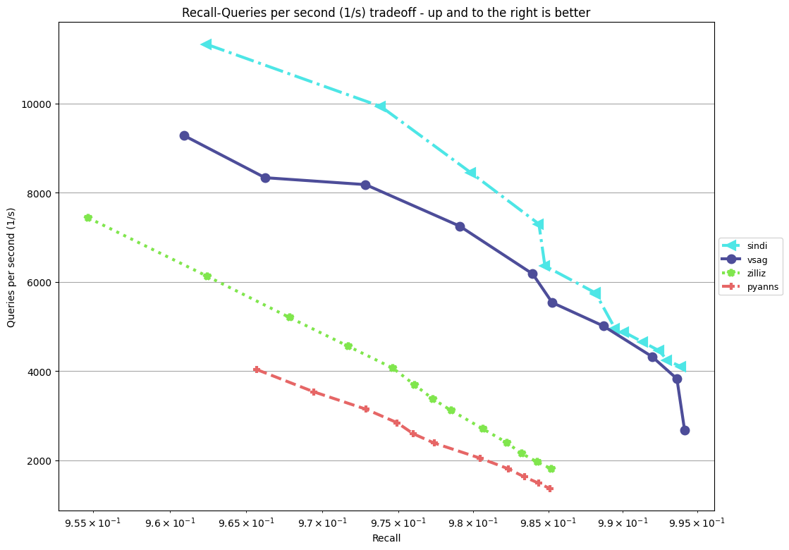
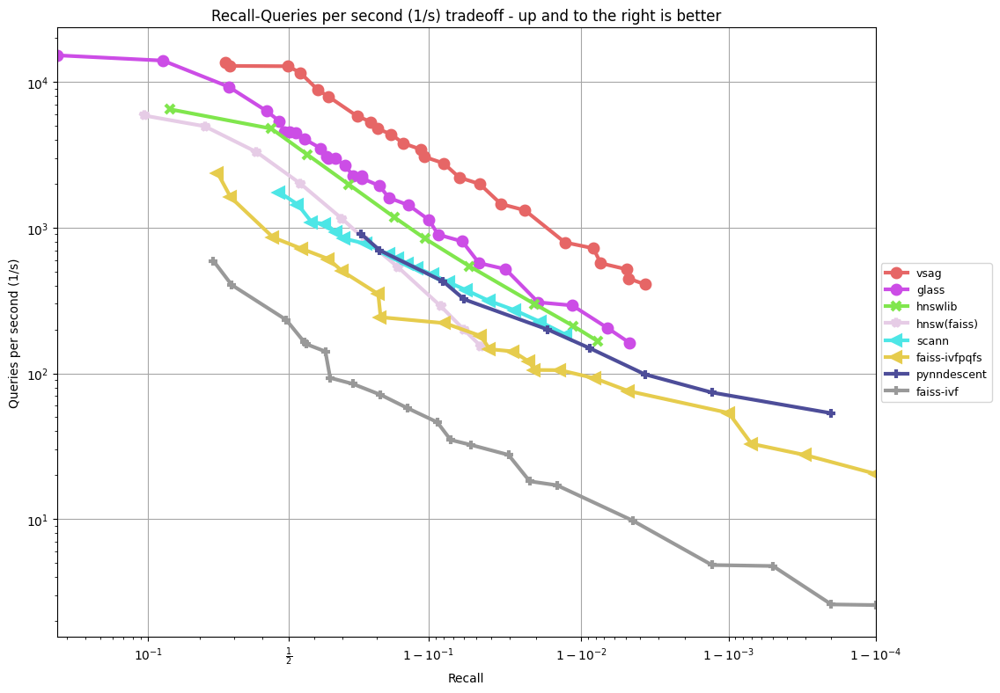
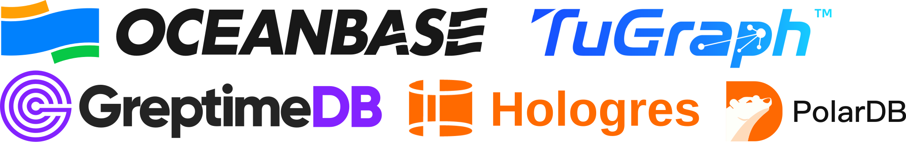

<!-- agent-hints
canonical: README.md
purpose: VSAG project landing page (intro, performance, Quickstart, links)
key-facts:
  - VSAG is a C++ vector indexing library with pyvsag (Python) and vsag (Node.js/TS) bindings
  - SINDI (sparse) and HGraph (dense) are the headline indexes
  - Quickstart blocks exist for C++, Python, and TypeScript
related:
  - AGENTS.md
  - DEVELOPMENT.md
  - docs/docs/en/src/guide/installation.md
last-reviewed: 2026-05-12
-->
<div align="center">
  <h1></h1>


[](https://codecov.io/gh/antgroup/vsag)


[](https://arxiv.org/abs/2505.03212)
[](https://arxiv.org/abs/2603.21710)
[](https://arxiv.org/abs/2509.08395)
[](https://arxiv.org/abs/2411.06158)
[](https://arxiv.org/abs/2503.17911)
[](https://arxiv.org/abs/2404.16322)
[](https://arxiv.org/abs/2506.13144)


[](https://pepy.tech/projects/pyvsag)
[](https://pepy.tech/projects/pyvsag)
[](https://pepy.tech/projects/pyvsag)
</div>


## What is VSAG

VSAG is a vector indexing library used for similarity search. The indexing algorithm allows users to search through various sizes of vector sets, especially those that cannot fit in memory. The library also provides methods for generating parameters based on vector dimensions and data scale, allowing developers to use it without understanding the algorithm’s principles. VSAG is written in C++ and provides a Python wrapper package called [pyvsag](https://pypi.org/project/pyvsag/) and a Node.js/TypeScript binding package called `vsag`.

HGraph supports experimental, opt-in adaptive alpha for PiPNN L2 builds; see the [HGraph parameter guide](docs/docs/en/src/indexes/hgraph.md).

## Performance
The VSAG algorithm SINDI for sparse vector search achieves a breakthrough in performance, substantially outperforming previous **state-of-the-art (SOTA)** solutions. In our internal tests on a 40-core Intel(R) Xeon(R) Silver 4210R CPU, VSAG's QPS exceeds that of the previous SOTA algorithm, Zilliz, by 166% on the sparse-full(8M) at 98% recall. While the official ann-benchmarks on sparse track runs on an Azure Standard D8lds v5 VM, we plan to submit our results under the official benchmark environment soon to formally validate this performance leap.

### sparse-full-inner-product


The VSAG algorithm achieves a significant boost of efficiency and outperforms the previous **state-of-the-art (SOTA)** by a clear margin. Specifically, VSAG's QPS exceeds that of the previous SOTA algorithm, Glass, by over 100%, and the baseline algorithm, HNSWLIB, by over 300% according to the ann-benchmark result on the GIST dataset at 90% recall. The test in [ann-benchmarks](https://ann-benchmarks.com/) is running on an r6i.16xlarge machine on AWS with `--parallelism 31`, single-CPU, and hyperthreading disabled. The result is as follows:

### gist-960-euclidean


## Getting Started

### Quickstart

Below is a minimal example of creating an HGraph index, building it with random vectors, and performing a k-NN search — shown in C++, Python, and TypeScript.

<details>
<summary><b>C++</b></summary>

```cpp
#include <vsag/vsag.h>
#include <iostream>
#include <random>

int main() {
    // Prepare data
    int64_t num_vectors = 1000, dim = 128;
    auto ids = new int64_t[num_vectors];
    auto vectors = new float[dim * num_vectors];
    std::mt19937 rng(47);
    std::uniform_real_distribution<float> dist;
    for (int64_t i = 0; i < num_vectors; ++i) ids[i] = i;
    for (int64_t i = 0; i < dim * num_vectors; ++i) vectors[i] = dist(rng);

    auto base = vsag::Dataset::Make();
    base->NumElements(num_vectors)->Dim(dim)->Ids(ids)->Float32Vectors(vectors);

    // Create and build index
    auto index = vsag::Factory::CreateIndex("hgraph", R"(
        {"dtype":"float32","metric_type":"l2","dim":128,
         "index_param":{"base_quantization_type":"fp32","max_degree":16,
         "ef_construction":100,"alpha":1.2}})").value();
    index->Build(base);

    // Search
    auto query_vector = new float[dim];
    for (int64_t i = 0; i < dim; ++i) query_vector[i] = dist(rng);
    auto query = vsag::Dataset::Make();
    query->NumElements(1)->Dim(dim)->Float32Vectors(query_vector)->Owner(true);

    auto result = index->KnnSearch(query, 10, R"({"hgraph":{"ef_search":100}})").value();
    for (int64_t i = 0; i < result->GetDim(); ++i)
        std::cout << result->GetIds()[i] << ": " << result->GetDistances()[i] << std::endl;
    return 0;
}
```

</details>

<details>
<summary><b>Python</b></summary>

```python
import pyvsag
import numpy as np
import json

dim = 128
num_elements = 1000

ids = list(range(num_elements))
data = np.float32(np.random.random((num_elements, dim)))

# Create and build index
index_params = json.dumps({
    "dtype": "float32", "metric_type": "l2", "dim": dim,
    "index_param": {"base_quantization_type": "fp32", "max_degree": 16,
                    "ef_construction": 100, "alpha": 1.2},
})
index = pyvsag.Index("hgraph", index_params)
index.build(vectors=data, ids=ids, num_elements=num_elements, dim=dim)

# Search
query = np.float32(np.random.random(dim))
search_params = json.dumps({"hgraph": {"ef_search": 100}})
result_ids, result_dists = index.knn_search(vector=query, k=10, parameters=search_params)
for rid, rdist in zip(result_ids, result_dists):
    print(f"{rid}: {rdist}")
```

</details>

<details>
<summary><b>TypeScript (Node.js)</b></summary>

```typescript
import { Index } from "vsag";

const dim = 128;
const numVectors = 1000;

const ids = new BigInt64Array(numVectors);
const vectors = new Float32Array(dim * numVectors);
for (let i = 0; i < numVectors; i++) ids[i] = BigInt(i);
for (let i = 0; i < dim * numVectors; i++) vectors[i] = Math.random();

// Create and build index
const indexParams = JSON.stringify({
    dtype: "float32", metric_type: "l2", dim,
    index_param: { base_quantization_type: "fp32", max_degree: 16,
                   ef_construction: 100, alpha: 1.2 },
});
const index = new Index("hgraph", indexParams);
index.build(vectors, ids, numVectors, dim);

// Search
const query = new Float32Array(dim);
for (let i = 0; i < dim; i++) query[i] = Math.random();

const searchParams = JSON.stringify({ hgraph: { ef_search: 100 } });
const { ids: resultIds, distances } = index.knnSearch(query, 10, searchParams);
for (let i = 0; i < 10; i++) {
    console.log(`${resultIds[i]}: ${distances[i]}`);
}
```

</details>

### Integrate with CMake

If you have already installed vsag (e.g. `cmake --install build-release` or via a distribution package), the recommended path is to use the shipped CMake package config and the imported `vsag::vsag` target:

```cmake
# CMakeLists.txt
cmake_minimum_required (VERSION 3.18)
project (myproject CXX)

set (CMAKE_CXX_STANDARD 11)
set (CMAKE_CXX_STANDARD_REQUIRED ON)

find_package (vsag CONFIG REQUIRED)

add_executable (vsag-cmake-example src/main.cpp)
target_link_libraries (vsag-cmake-example PRIVATE vsag::vsag)
```

Point CMake at the install prefix via `-DCMAKE_PREFIX_PATH=/path/to/install` if vsag is not in a system location.

Alternatively, to fetch and build vsag from source as part of your project:

```cmake
# CMakeLists.txt
cmake_minimum_required (VERSION 3.18)
project (myproject CXX)

set (CMAKE_CXX_STANDARD 11)
set (CMAKE_CXX_STANDARD_REQUIRED ON)

include (FetchContent)
FetchContent_Declare (
  vsag
  GIT_REPOSITORY https://github.com/antgroup/vsag
  GIT_TAG main
)
FetchContent_MakeAvailable (vsag)

add_executable (vsag-cmake-example src/main.cpp)
target_include_directories (vsag-cmake-example SYSTEM PRIVATE ${vsag_SOURCE_DIR}/include)
target_link_libraries (vsag-cmake-example PRIVATE vsag)
add_dependencies (vsag-cmake-example vsag)
```

### Examples

C++, Python, and TypeScript examples are provided. Please explore the [examples](./examples/) directory for details.

We suggest you start with:
- **C++**: [103_index_hgraph.cpp](./examples/cpp/103_index_hgraph.cpp)
- **Python**: [103_index_hgraph.py](./examples/python/103_index_hgraph.py)
- **TypeScript**: [103_index_hgraph.ts](./examples/typescript/103_index_hgraph.ts)

## Building from Source
Please read the [DEVELOPMENT](./DEVELOPMENT.md) guide for instructions on how to build.

## Who's Using VSAG
- [OceanBase](https://github.com/oceanbase/oceanbase)
- [TuGraph](https://github.com/TuGraph-family/tugraph-db)
- [GreptimeDB](https://github.com/GreptimeTeam/greptimedb)
- [Hologres](https://www.aliyun.com/product/bigdata/hologram)
- [PolarDB](https://www.aliyun.com/product/polardb/mysql)



If your system uses VSAG, then feel free to make a pull request to add it to the list.

## How to Contribute
Although VSAG is initially developed by the Vector Database Team at Ant Group, it's the work of the [community](https://github.com/antgroup/vsag/graphs/contributors), and contributions are always welcome! See [CONTRIBUTING](./CONTRIBUTING.md) for ways to get started.

Need help filing an issue? Run `/create-issue` inside Claude Code, OpenCode or Codex, or use the [`tools/issue-helper/`](./tools/issue-helper/README.md) shell wrapper. The drafting rules live in [`.github/ISSUE_TEMPLATE/ISSUE_GUIDE.md`](./.github/ISSUE_TEMPLATE/ISSUE_GUIDE.md).

## Community


Thrive together in VSAG community with users and developers from all around the world.

- Discuss at [discord](https://discord.com/invite/JyDmUzuhrp).
- Follow us on [Weixin Official Accounts](./docs/weixin-qr.jpg)（微信公众平台）to get the latest news.

## Roadmap v1.2 (ETA Dec. 2026)

- **Adaptive and Concurrent Search**
  - **Elastic `ef_search`**: Adapt search effort to individual queries to balance recall and latency.
  - **Multi-Core Search Scalability**: Improve concurrent search throughput through better cache utilization, memory access, and NUMA awareness.

- **Unified Indexing and Hybrid Retrieval**
  - **HGraph v2**: Integrate capabilities from LazyHGraph, MCI, and Pyramid into a unified index with comprehensive filtering and search optimizations.
  - **Dense–Sparse Hybrid Search**: Support retrieval that combines dense and sparse similarity with configurable query-time weights.
  - **SINDI_V2**: Complete the sparse-vector index introduced in v1.1 as a work in progress, with optimized in-memory and disk-based search.
  - **Hamming Distance**: Enable similarity search over binary vectors.
  - **Grouped Retrieval**: Support multiple vectors per entity with collapsed and expanded search results.

- **Faster Index Construction and Balanced Partitioning**
  - **GPU-Accelerated HGraph Construction**: Accelerate graph building with GPU computation.
  - **Random Projection Tree Partitioning**: Provide balanced, reproducible partitions for clustering and parallel index construction.
  - **Balanced K-Means**: Add capacity-constrained clustering to produce balanced IVF partitions.
  - **Efficient Graph Merging and Reuse**: Reuse existing graph structures during index merging and parameter tuning to reduce construction costs.

- **Advanced Quantization**
  - **SAQ Quantization**: Introduce code adjustment and dimension segmentation for improved quantization efficiency and accuracy.
  - **Multi-Centroid Residual RaBitQ**: Improve compression quality by quantizing residuals around multiple centroids.
  - **Efficient Scalar Quantization**: Optimize local SQ4/SQ8 computation and reduce redundant storage between search and reranking.

- **Index Diagnostics and Capacity Planning**
  - **New Index Diagnostics**: Expand index inspection and query analysis to help identify index-quality and search-performance bottlenecks.
  - **Dataset Profiling and Visualization**: Analyze vector distributions, sparsity, clustering structure, and distance characteristics.
  - **HGraph Build Memory Estimator**: Estimate peak construction memory before starting an index build.
  - **Pip-Installable Analysis Tools**: Make index diagnostics available through `pyvsag` without requiring a source build.

- **Lightweight Deployment and Storage Integration**
  - **VSAG Lite**: Provide a lightweight variant with essential indexing, search, update, and persistence capabilities for resource-constrained deployments.
  - **Pluggable Storage I/O**: Extend custom reader and writer support for external storage integration.
  - **Lower Memory Footprint**: Reduce redundant storage in immutable indexes and improve binary distribution packaging.

- **Python and RAG Ecosystem**
  - **LangChain Integration**: Provide a `pyvsag` VectorStore adapter for document retrieval and RAG workflows.
  - **Sparse Input Helpers**: Simplify conversion from named term-weight mappings to SINDI-compatible sparse vectors.

## Our Publications

1. Elastic Index Selection for Label-Hybrid AKNN Search [_VLDB_, 2026]  
   **Mingyu Yang**, Wenxuan Xia, Wentao Li, Raymond Chi-Wing Wong, Wei Wang  
   [PDF](https://www.vldb.org/pvldb/vol19/p617-yang.pdf) | [DOI](https://doi.org/10.14778/3785297.3785304)

2. FGIM: a Fast Graph-based Indexes Merging Framework for Approximate Nearest Neighbor Search [_SIGMOD_, 2026]  
   **Zekai Wu, Jiabao Jin**, Peng Cheng, **Xiaoyao Zhong**, Lei Chen, Yongxin Tong, **Zhitao Shen**, Jingkuan Song, Heng Tao Shen, Xuemin Lin  
   [PDF](https://dl.acm.org/doi/pdf/10.1145/3786651) | [DOI](https://doi.org/10.1145/3786651)

3. SINDI: an Efficient Index for Approximate Maximum Inner Product Search on Sparse Vectors [_ICDE_, 2026]  
   **Ruoxuan Li, Xiaoyao Zhong, Jiabao Jin**, Peng Cheng, Wangze Ni, Lei Chen, **Zhitao Shen, Wei Jia, Xiangyu Wang**, Xuemin Lin, Heng Tao Shen, Jingkuan Song  
   [PDF](https://arxiv.org/pdf/2509.08395) | [DOI](https://doi.org/10.1109/ICDE65706.2026.00208)

4. Quantization Meets Projection: A Happy Marriage for Approximate k-Nearest Neighbor Search [_VLDB_, 2026]  
   **Mingyu Yang**, Liuchang Jing, Wentao Li, Wei Wang  
   [PDF](https://www.vldb.org/pvldb/vol19/p1240-yang.pdf) | [DOI](https://doi.org/10.14778/3797919.3797931)

5. VSAG: An Optimized Search Framework for Graph-based Approximate Nearest Neighbor Search [_VLDB (industry)_, 2025]  
   **Xiaoyao Zhong, Haotian Li, Jiabao Jin, Mingyu Yang, Deming Chu, Xiangyu Wang, Zhitao Shen, Wei Jia**, George Gu, Yi Xie, Xuemin Lin, Heng Tao Shen, Jingkuan Song, Peng Cheng  
   [PDF](https://www.vldb.org/pvldb/vol18/p5017-cheng.pdf) | [DOI](https://doi.org/10.14778/3750601.3750624)

6. Effective and General Distance Computation for Approximate Nearest Neighbor Search [_ICDE_, 2025]  
   **Mingyu Yang**, Wentao Li, **Jiabao Jin, Xiaoyao Zhong, Xiangyu Wang, Zhitao Shen**, **Wei Jia,** Wei Wang \
   [PDF](https://arxiv.org/pdf/2404.16322) | [DOI](https://doi.org/10.1109/ICDE65448.2025.00087)  

7. EnhanceGraph: A Continuously Enhanced Graph-based Index for High-dimensional Approximate Nearest Neighbor Search [_TKDE_] \
   **Xiaoyao Zhong, Jiabao Jin**, Peng Cheng, **Mingyu Yang**, Lei Chen, Haoyang Li, **Zhitao Shen**, Xuemin Lin, Heng Tao Shen, Jingkuan Song  
   [PDF](https://ieeexplore.ieee.org/stamp/stamp.jsp?tp=&arnumber=11663430) | [DOI](https://doi.org/10.1109/TKDE.2026.3726767)

## Reference

VSAG draws on the following works for graph construction, vector quantization, filtered search, and integer compression:

1. Efficient and Robust Approximate Nearest Neighbor Search Using Hierarchical Navigable Small World Graphs [_TPAMI_, 2020] \
   Yu. A. Malkov, D. A. Yashunin \
   Hierarchical graph construction and search in HGraph. \
   [PDF](https://arxiv.org/pdf/1603.09320) | [DOI](https://doi.org/10.1109/TPAMI.2018.2889473)

2. Efficient K-Nearest Neighbor Graph Construction for Generic Similarity Measures [_WWW_, 2011] \
   Wei Dong, Moses Charikar, Kai Li \
   NN-Descent neighbor refinement underlying the ODescent graph builder. \
   [PDF](https://www.cs.princeton.edu/cass/papers/www11.pdf) | [DOI](https://doi.org/10.1145/1963405.1963487)

3. PiPNN: Ultra-Scalable Graph-Based Nearest Neighbor Indexing [_arXiv_, 2026] \
   Tobias Rubel, Richard Wen, Laxman Dhulipala, Lars Gottesbüren, Rajesh Jayaram, Jakub Łącki \
   Parallel graph construction in the PiPNN builder used by HGraph and Pyramid. \
   [PDF](https://arxiv.org/pdf/2602.21247) | [CODE](https://github.com/ParAlg/PiPNN)

4. Product Quantization for Nearest Neighbor Search [_TPAMI_, 2011] \
   Hervé Jégou, Matthijs Douze, Cordelia Schmid \
   Subspace codebooks and lookup-table distance computation in the product quantizer. \
   [PDF](https://inria.hal.science/inria-00514462v2/file/jegou_pq_postprint.pdf) | [DOI](https://doi.org/10.1109/TPAMI.2010.57)

5. RaBitQ: Quantizing High-Dimensional Vectors with a Theoretical Error Bound for Approximate Nearest Neighbor Search [_SIGMOD_, 2024] \
   Jianyang Gao, Cheng Long \
   Randomized binary quantization and distance estimation in the RaBitQ quantizer. \
   [PDF](https://dl.acm.org/doi/pdf/10.1145/3654970) | [DOI](https://doi.org/10.1145/3654970) | [CODE](https://github.com/VectorDB-NTU/RaBitQ-Library)

6. Practical and Asymptotically Optimal Quantization of High-Dimensional Vectors in Euclidean Space for Approximate Nearest Neighbor Search [_SIGMOD_, 2025] \
   Jianyang Gao, Yutong Gou, Yuexuan Xu, Yongyi Yang, Cheng Long, Raymond Chi-Wing Wong \
   Multi-bit quantization in the extended RaBitQ implementation. \
   [PDF](https://arxiv.org/pdf/2409.09913) | [DOI](https://doi.org/10.1145/3725413)

7. SAQ: Pushing the Limits of Vector Quantization through Code Adjustment and Dimension Segmentation [_SIGMOD_, 2026] \
   Hui Li, Shiyuan Deng, Xiao Yan, Xiangyu Zhi, James Cheng \
   Code adjustment for the optional fast encoding path in the RaBitQ quantizer. \
   [PDF](https://arxiv.org/pdf/2509.12086) | [DOI](https://doi.org/10.1145/3769824)

8. MCI: A Maximal Clique Index for Efficient Arbitrary-Filtered Approximate Nearest Neighbor Search [_arXiv_, 2026] \
   Xiaowei Ye, Rong-Hua Li, Guoren Wang, Kaiwen Xue, Daiyin Wang, Xubin Li \
   Clique-based indexing and filtered search in HGraph's MCI mode. \
   [PDF](https://arxiv.org/pdf/2604.22171)

9. Quasi-succinct Indices [_WSDM_, 2013] \
   Sebastiano Vigna \
   Elias–Fano integer encoding in the compression implementation. \
   [PDF](https://dl.acm.org/doi/pdf/10.1145/2433396.2433409) | [DOI](https://doi.org/10.1145/2433396.2433409)

## Contributors

<!-- prettier-ignore-start -->
<!-- markdownlint-disable -->
<!-- readme: contributors -start -->
<table>
    <tbody>
        <tr>
            <td align="center">
                <a href="https://github.com/LHT129">
                    
                    <br />
                    <sub><b>LHT129</b></sub>
                </a>
            </td>
            <td align="center">
                <a href="https://github.com/wxyucs">
                    
                    <br />
                    <sub><b>Xiangyu Wang</b></sub>
                </a>
            </td>
            <td align="center">
                <a href="https://github.com/inabao">
                    
                    <br />
                    <sub><b>inabao</b></sub>
                </a>
            </td>
            <td align="center">
                <a href="https://github.com/ShawnShawnYou">
                    
                    <br />
                    <sub><b>ShawnShawnYou</b></sub>
                </a>
            </td>
            <td align="center">
                <a href="https://github.com/jac0626">
                    
                    <br />
                    <sub><b>jac</b></sub>
                </a>
            </td>
            <td align="center">
                <a href="https://github.com/Roxanne0321">
                    
                    <br />
                    <sub><b>Roxanne</b></sub>
                </a>
            </td>
        </tr>
        <tr>
            <td align="center">
                <a href="https://github.com/LightWant">
                    
                    <br />
                    <sub><b>LightWant</b></sub>
                </a>
            </td>
            <td align="center">
                <a href="https://github.com/vsag-bot">
                    
                    <br />
                    <sub><b>vsag-bot</b></sub>
                </a>
            </td>
            <td align="center">
                <a href="https://github.com/Coien-rr">
                    
                    <br />
                    <sub><b>Cooper</b></sub>
                </a>
            </td>
            <td align="center">
                <a href="https://github.com/Carrot-77">
                    
                    <br />
                    <sub><b>Carrot-77</b></sub>
                </a>
            </td>
            <td align="center">
                <a href="https://github.com/jfeng18">
                    
                    <br />
                    <sub><b>Jiangtian Feng</b></sub>
                </a>
            </td>
            <td align="center">
                <a href="https://github.com/nedchu">
                    
                    <br />
                    <sub><b>Deming Chu</b></sub>
                </a>
            </td>
        </tr>
        <tr>
            <td align="center">
                <a href="https://github.com/shadowao">
                    
                    <br />
                    <sub><b>azl</b></sub>
                </a>
            </td>
            <td align="center">
                <a href="https://github.com/yulijunzj">
                    
                    <br />
                    <sub><b>L J. Yun</b></sub>
                </a>
            </td>
            <td align="center">
                <a href="https://github.com/misaka0714">
                    
                    <br />
                    <sub><b>baoyuan</b></sub>
                </a>
            </td>
            <td align="center">
                <a href="https://github.com/dasurax">
                    
                    <br />
                    <sub><b>dasurax</b></sub>
                </a>
            </td>
            <td align="center">
                <a href="https://github.com/jingyueob">
                    
                    <br />
                    <sub><b>jingyueob</b></sub>
                </a>
            </td>
            <td align="center">
                <a href="https://github.com/Sia-Sheerland">
                    
                    <br />
                    <sub><b>Wen Huanzhi</b></sub>
                </a>
            </td>
        </tr>
        <tr>
            <td align="center">
                <a href="https://github.com/xfmeng17">
                    
                    <br />
                    <sub><b>XFMENG17</b></sub>
                </a>
            </td>
            <td align="center">
                <a href="https://github.com/antfin-oss">
                    
                    <br />
                    <sub><b>Ant OSS</b></sub>
                </a>
            </td>
            <td align="center">
                <a href="https://github.com/pkusunjy">
                    
                    <br />
                    <sub><b>Sun Jiayu</b></sub>
                </a>
            </td>
            <td align="center">
                <a href="https://github.com/thlurte">
                    
                    <br />
                    <sub><b>Adheeb Ahmed</b></sub>
                </a>
            </td>
            <td align="center">
                <a href="https://github.com/Danbaiwq">
                    
                    <br />
                    <sub><b>Danbaiwq</b></sub>
                </a>
            </td>
            <td align="center">
                <a href="https://github.com/Hastyshell">
                    
                    <br />
                    <sub><b>Siyang Tang</b></sub>
                </a>
            </td>
        </tr>
        <tr>
            <td align="center">
                <a href="https://github.com/HeHuMing">
                    
                    <br />
                    <sub><b>HuMing He</b></sub>
                </a>
            </td>
            <td align="center">
                <a href="https://github.com/jiacai2050">
                    
                    <br />
                    <sub><b>Jiacai Liu</b></sub>
                </a>
            </td>
            <td align="center">
                <a href="https://github.com/lyxiong0">
                    
                    <br />
                    <sub><b>Liyao Xiong</b></sub>
                </a>
            </td>
            <td align="center">
                <a href="https://github.com/mly5269">
                    
                    <br />
                    <sub><b>mly</b></sub>
                </a>
            </td>
            <td align="center">
                <a href="https://github.com/Ningsir">
                    
                    <br />
                    <sub><b>Xinger</b></sub>
                </a>
            </td>
            <td align="center">
                <a href="https://github.com/seuclkzsd">
                    
                    <br />
                    <sub><b>seuclkzsd</b></sub>
                </a>
            </td>
        </tr>
        <tr>
            <td align="center">
                <a href="https://github.com/CharlesXu-HQ">
                    
                    <br />
                    <sub><b>Charles xu</b></sub>
                </a>
            </td>
            <td align="center">
                <a href="https://github.com/cubicc">
                    
                    <br />
                    <sub><b>cubicc</b></sub>
                </a>
            </td>
            <td align="center">
                <a href="https://github.com/geerniman">
                    
                    <br />
                    <sub><b>Geerniman</b></sub>
                </a>
            </td>
            <td align="center">
                <a href="https://github.com/hhy3">
                    
                    <br />
                    <sub><b>Zihao Wang</b></sub>
                </a>
            </td>
            <td align="center">
                <a href="https://github.com/jiaweizone">
                    
                    <br />
                    <sub><b>wei</b></sub>
                </a>
            </td>
            <td align="center">
                <a href="https://github.com/liric24">
                    
                    <br />
                    <sub><b>liric24</b></sub>
                </a>
            </td>
        </tr>
        <tr>
            <td align="center">
                <a href="https://github.com/mingyu-hkustgz">
                    
                    <br />
                    <sub><b>Mingyu Yang</b></sub>
                </a>
            </td>
            <td align="center">
                <a href="https://github.com/mukejane">
                    
                    <br />
                    <sub><b>mukejane</b></sub>
                </a>
            </td>
            <td align="center">
                <a href="https://github.com/shenguoquan">
                    
                    <br />
                    <sub><b>guoquan</b></sub>
                </a>
            </td>
            <td align="center">
                <a href="https://github.com/skylhd">
                    
                    <br />
                    <sub><b>lhd</b></sub>
                </a>
            </td>
            <td align="center">
                <a href="https://github.com/stuBirdFly">
                    
                    <br />
                    <sub><b>stuBirdFly</b></sub>
                </a>
            </td>
            <td align="center">
                <a href="https://github.com/wellkilo">
                    
                    <br />
                    <sub><b>He Dong</b></sub>
                </a>
            </td>
        </tr>
        <tr>
            <td align="center">
                <a href="https://github.com/ykindred">
                    
                    <br />
                    <sub><b>ykindred</b></sub>
                </a>
            </td>
        </tr>
    </tbody>
</table>
<!-- readme: contributors -end -->
<!-- markdownlint-restore -->
<!-- prettier-ignore-end -->

## Star History

[](https://star-history.com/#antgroup/vsag&Date)

## License
[Apache License 2.0](./LICENSE)
