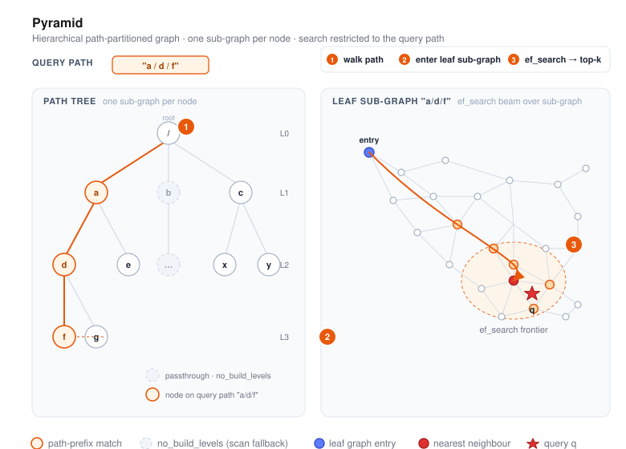

# Pyramid



Pyramid is VSAG's **hierarchical, path-partitioned** graph index. A vector can be
tagged with one or multiple path strings such as `"a/d/f"`, and Pyramid
builds a graph per node in those path trees. At query time you supply one or more
path prefixes, and Pyramid restricts the search to the corresponding sub-trees.

This is ideal for multi-tenant deployments, tag-partitioned catalogs, or any
scenario where one logical index serves many groups that must not cross-contaminate
results.

- Source: `src/algorithm/pyramid.{h,cpp}`, `src/algorithm/pyramid_zparameters.{h,cpp}`
- Example (single hierarchy): [`examples/cpp/107_index_pyramid.cpp`](https://github.com/antgroup/vsag/blob/main/examples/cpp/107_index_pyramid.cpp)
- Example (multi-hierarchy): [`examples/cpp/112_index_pyramid_multi_hierarchy.cpp`](https://github.com/antgroup/vsag/blob/main/examples/cpp/112_index_pyramid_multi_hierarchy.cpp)

## Read-only indexes

`SetImmutable()` rejects further writes and releases per-vector locks, while retaining
the reverse ID map for efficient ID-based distance and retrieval operations. The map
uses additional memory compared with discarding it, but avoids linear ID scans.
This applies whether the index is frozen before or after deserialization; the
serialized format is unchanged.

## How it works

1. **Path tree.** Each vector can carry independent paths in addition to its id.
   Paths use `/` as separator (e.g. `"tenant_a/lang_en/topic_news"`). Pyramid
   builds one sub-index for every path prefix seen during build. The vector data
   and id are stored once even when the vector belongs to multiple paths.
2. **Per-level sub-graphs.** By default every level gets its own proximity graph.
   Use `no_build_levels` to skip levels that are too small or too coarse to
   benefit from graph indexing — those levels still exist as passthrough
   containers, but search degrades to a scan.
3. **Graph construction.** Each sub-graph is built with the same machinery as
   HGraph: `nsw` insertion or `odescent` with `graph_iter_turn`,
   `neighbor_sample_rate`, and `alpha` for pruning. Base vectors are stored in
   `base_quantization_type`; optional reordering keeps a high-precision copy.
4. **Search.** Query vectors also carry a path. The search walks down the tree
   to the most specific sub-graph matching the query path and runs a graph search
   there with `ef_search` (and `subindex_ef_search` for intermediate levels).

## Quick start

```cpp
#include <vsag/vsag.h>

std::string params = R"({
    "dtype": "float32",
    "metric_type": "l2",
    "dim": 128,
    "index_param": {
        "base_quantization_type": "sq8",
        "max_degree": 32,
        "alpha": 1.2,
        "graph_type": "odescent",
        "graph_iter_turn": 15,
        "neighbor_sample_rate": 0.2,
        "no_build_levels": [0, 1],
        "use_reorder": true,
        "build_thread_count": 16
    }
})";
auto index = vsag::Factory::CreateIndex("pyramid", params).value();

// Build with per-vector paths.
auto base = vsag::Dataset::Make();
base->NumElements(n)
    ->Dim(128)
    ->Ids(ids)
    ->Paths(paths)          // std::string* of length n, e.g. "a/d/f"
    ->Float32Vectors(data)
    ->Owner(false);
index->Build(base);

// Search restricted to a path prefix.
std::string query_path = "a/d";
auto query = vsag::Dataset::Make();
query->NumElements(1)
    ->Dim(128)
    ->Float32Vectors(q)
    ->Paths(&query_path)
    ->Owner(false);
auto result = index->KnnSearch(
    query, /*topk=*/10,
    R"({"pyramid": {"ef_search": 100}})").value();
```

## Input data type

Pyramid accepts `dtype: "float16"` and `dtype: "bfloat16"` input for `Build`, `Add`, and search, as well as the existing `"float32"` input. The input `dtype` is distinct from the storage quantizer: use `"float16"` / `"bfloat16"` for `dtype`, but `"fp16"` / `"bf16"` for quantization parameters.

For either half input type, supply `Dataset::Float16Vectors` with a contiguous `uint16_t` buffer containing the **encoded FP16 or BF16 bit patterns**, not integers obtained by numerically casting floats. `dtype` determines how these bits are interpreted. Build/Add buffers contain `NumElements() * Dim()` entries; query buffers must use the same input format as the index. Supply IDs and paths as in the example above, replacing `Float32Vectors(data)` and `Float32Vectors(q)` with `Float16Vectors(half_data)` and `Float16Vectors(half_query)`. With `Owner(false)`, keep the borrowed buffers (including IDs and paths) alive for the operation.

For half input, supported `base_quantization_type` and, when `use_reorder` is `true`, `precise_quantization_type` values are `fp16`, `bf16`, `pq`, `sq8`, and `fp32`. Quantizer-specific requirements still apply (for example, PQ training and dimension settings). A minimal matching-format configuration is:

```json
{
    "dtype": "float16",
    "metric_type": "l2",
    "dim": 32,
    "index_param": {
        "graph_type": "nsw",
        "base_quantization_type": "fp16",
        "use_reorder": false
    }
}
```

For BF16 input with BF16 storage, change `dtype` to `"bfloat16"` and `base_quantization_type` to `"bf16"`. Cross-format storage conversion is also supported, such as FP16 input with BF16 storage or BF16 input with FP32 storage; this does not change the required input format of subsequent queries. `metric_type: "cosine"` normalizes vectors before encoding, so matching-format input does not imply byte-for-byte preservation for cosine.

For L2/IP, matching FP16-to-FP16 and BF16-to-BF16 storage preserves the input bit patterns verbatim. Cross-format storage and `pq`/`sq8`/`fp32` storage convert the input through float32; they do not provide the same half-bit preservation guarantee.

For `CalcDistanceById` and `CalcDistancesById` on half-input indexes, use the `DatasetPtr` overload with a native half query buffer matching the index dtype. The raw `const float*` overloads accept only float32 indexes and reject half-input indexes.

An FP16 or BF16 stored vector code occupies `2 * dim` bytes, compared with `4 * dim` for FP32. This is **vector-code size, not total index memory**: graphs, IDs, paths, allocation overhead, and any reorder/raw-vector copies also consume space. Half input alone does not select half storage or halve total memory.

Use `graph_type: "nsw"` or `"odescent"` with half input. **PiPNN remains float32-only.** These guarantees describe Pyramid, not every VSAG index.

## Build parameters

Build-time parameters live under `index_param`.

| Parameter | Type | Default | Description |
|-----------|------|---------|-------------|
| `base_quantization_type` | string | — | Coarse storage quantizer (`fp32`, `fp16`, `bf16`, `sq8`, `sq4`, `sq8_uniform`, `sq4_uniform`, `pq`, `pqfs`, `rabitq`, `tq`). See the [Quantization chapter](../quantization/) for per-quantizer details. |
| `tq_chain` | string | — | Transform chain used when `base_quantization_type` is `tq`, for example `"mrle, rabitq"`. |
| `mrle_dim` | int | `0` | Prefix dimension retained by MRLE; `0` keeps the input dimension. |
| `max_degree` | int | `64` | Maximum out-degree per node within a sub-graph. |
| `graph_type` | string | `"nsw"` | `nsw`, `odescent`, or `pipnn`. PiPNN batch-builds every constructed graph in each hierarchy, including root routing layers for `multi_layer` roots. |
| `graph_storage_type` | string | `"flat"` | Bottom-graph storage for a `multi_layer` root: `flat` favors construction and search speed, while `compressed` reduces graph memory. Compressed storage requires `max_degree <= 255`. Single-layer roots, routing graphs, and child graphs remain sparse. |
| `ef_construction` | int | `400` | Candidate list size for `nsw` builds. |
| `alpha` | float | `1.2` | Pruning factor during graph construction; PiPNN requires a finite value at least `1.0`. |
| `adaptive_pruning` | boolean | `false` | Optional NSW bottom forward/reverse L2 selector; see [configuration and scope](#experimental-adaptive-nsw-pruning). |
| `graph_iter_turn` | int | — | ODescent iterations (effective with `graph_type: "odescent"`). |
| `neighbor_sample_rate` | float | — | ODescent neighbor sampling rate. |
| `pipnn_max_leaf_size` | int | `1024` | Maximum PiPNN partition leaf size. |
| `pipnn_min_leaf_size` | int | `64` | Target used when PiPNN merges undersized leaves. |
| `pipnn_leader_sample_rate` | float | `0.005` | Fraction sampled as leaders; each partition uses `2` to `1000`, bounded by its point count. |
| `pipnn_fanout` | int[] | `[10, 2]` | Nearest leader partitions joined at successive PiPNN partition levels. |
| `pipnn_leaf_neighbor_count` | int | `5` | Nearest candidates contributed per point and leaf; the primary PiPNN quality/build-work knob. Undersized leaves use at least `4`. |
| `pipnn_hash_plane_count` | int | `12` | Direction-hash bits, in `[1, 15]`; `max_degree <= 2^pipnn_hash_plane_count`. |
| `pipnn_reservoir_size` | int | `64` | Candidate slots retained per point before final pruning; effective capacity is at least `max_degree`. |
| `no_build_levels` | int[] | `[]` | Tree levels that skip graph construction (0-indexed from the root). |
| `use_reorder` | bool | `false` | Keep a high-precision copy for rescoring. |
| `precise_quantization_type` | string | `"fp32"` | Quantizer for reordering. Use `"rabitq"` with `rabitq_bits_per_dim_precise` to enable RaBitQ x+y split reorder from base storage. |
| `rabitq_bits_per_dim_base` | int | `1` | RaBitQ stored-code bits. In x+y split mode, this is `x`, the filter bits used during graph traversal; allowed range is `[1, 8]`. |
| `rabitq_bits_per_dim_precise` | int | unset | RaBitQ split `y` bits. When set with `base_quantization_type: "rabitq"` and `precise_quantization_type: "rabitq"`, Pyramid uses split storage; `rabitq_bits_per_dim_base` remains `x`, and `x + y <= 8`. |
| `fast_encode_rabitq` | bool | `true` | Use the fast multi-bit RaBitQ encoder for RaBitQ base or precise storage; set to `false` for the exact encoder. |
| `fast_encode_rabitq_rounds` | int | `6` | Fast RaBitQ refinement rounds in `[1, 32]`. |
| `base_io_type` / `precise_io_type` | string | `"block_memory_io"` | Base and reorder storage backends; `uring_io` is available in builds with liburing. |
| `base_file_path` / `precise_file_path` | string | — | Required for disk-backed storage such as `buffer_io`, `async_io`, `uring_io`, or `mmap_io`. |
| `store_raw_vector` | bool | `false` | Preserve an FP32 copy for `GetRawVectorByIds` and precise distance-by-id calculations. |
| `store_paths` | bool | `false` | Top-level switch that preserves the original paths supplied to `Build` and `Add` so `GetDataByIdsWithFlag` can return them when `DATA_FLAG_PATH` is selected. It applies to every configured hierarchy and cannot be overridden per hierarchy. |
| `index_min_size` | int | `0` | Minimum sub-index size; smaller groups fall back to scan. |
| `route_min_size` | int | `0` | Automatic routing threshold for each node, including children. `0` disables automatic promotion; a positive value enables sparse routing layers once its physical bottom-graph row count reaches this size. Supports NSW and PiPNN; requires `max_degree > 1`. |
| `root_graph_type` | string | `"single_layer"` | Root graph layout: `single_layer` preserves the original sparse bottom graph; `multi_layer` uses a preallocated Flat or Compressed bottom graph with HGraph-style sparse routing layers and joint construction. `multi_layer` supports `graph_type: "nsw"` and `"pipnn"`. Do not specify this option when `no_build_levels` disables level 0. |
| `support_duplicate` | bool | `false` | Group code-equivalent vectors with distinct external labels, using construction-code `CompareVectors` semantics. External labels must remain unique. |
| `build_thread_count` | int | `1` | Threads used for parallel build. |
| `hierarchies` | array | `[]` | Named hierarchy definitions. Each element is either a string (inherits all top-level params) or an object with `name` and optional overrides (`max_degree`, `ef_construction`, `alpha`, `no_build_levels`, `index_min_size`, `route_min_size`, `root_graph_type`). When present, multi-hierarchy mode is activated and each hierarchy maintains its own independent path tree. |

PiPNN supports Pyramid builds with `dtype: "float32"` and `metric_type` set to `"l2"`, `"ip"`, or
`"cosine"`. It batch-builds every constructed graph in each hierarchy; with
`root_graph_type: "multi_layer"`, this also includes every root routing layer. Search, incremental
`Add`, removal, duplicate handling, reorder, and serialization retain the standard Pyramid
behavior. Levels in `no_build_levels` are still skipped.
The `pipnn_*` values are global to the Pyramid index; hierarchy objects may continue to override
`max_degree` and `alpha`, and those overrides are applied when PiPNN builds that hierarchy.
`ef_construction` does not tune PiPNN.

### RaBitQ split configuration

Set all five parameters together to enable RaBitQ x+y split storage and reordering:

```json
{
    "use_reorder": true,
    "base_quantization_type": "rabitq",
    "precise_quantization_type": "rabitq",
    "rabitq_bits_per_dim_base": 3,
    "rabitq_bits_per_dim_precise": 5
}
```

Pyramid uses split-code code-to-code distances for incremental flat-to-graph promotion, so it does
not retain an internal FP32 copy by default. Set `store_raw_vector` to `true` at build time when
raw-vector access and complete analyzer metrics are required.

### MRLE with split RaBitQ

Pyramid can truncate embeddings trained with Matryoshka Representation Learning before encoding
them as split RaBitQ codes:

```json
{
    "base_quantization_type": "tq",
    "tq_chain": "mrle, rabitq",
    "mrle_dim": 1280,
    "precise_quantization_type": "rabitq",
    "rabitq_bits_per_dim_base": 3,
    "rabitq_bits_per_dim_precise": 5,
    "use_reorder": true
}
```

The 3-bit filter planes are used for graph traversal and the 5-bit supplement planes for
reordering; both encode the same truncated vector. Pyramid uses split code-to-code distances for
graph promotion and does not retain the original FP32 vectors. Metrics that require decodable
vectors are marked unavailable unless `store_raw_vector` was enabled at build time. Truncation can
reduce recall unless the embedding model was trained for prefix dimensions.

## Build cache

`ExportCache` captures per-hierarchy, per-node NSW graph seeds and `ImportCache` makes them available to a later `Build`. Cache data uses the index cache payload format, not the streaming index serialization format. Set `persist_source_id: true` before footer-serializing an index whose cache will be reused, and provide a unique `Dataset::SourceID` and external label for every vector in both builds. Cache warm builds apply only to `graph_type: "nsw"`; ODescent, missing source IDs, and repeated source IDs or labels fall back to a normal cold build (which retains its normal repeated-label rejection behavior). `ef_construction` is not an eligibility condition. At least 80% of input source IDs must overlap the imported cache. Cache misses are constructed normally. Single-layer root hits receive forward-row repair; multi-layer nodes rebuild routing overlays, which are not cached.

With `support_duplicate: true`, Pyramid stores explicit per-graph group membership and the actual adjacency-row owner, not the minimum label or inner ID. Warm construction remaps SourceIDs and verifies current graph membership and construction-code equality. Missing or moved representatives, changed equivalence classes and unusable class rows turn the affected classes into misses; unrelated valid classes remain reusable. Removed aliases alone do not invalidate their class. Newly merged code classes are conservatively rebuilt. Hash-keyed ordered indexes compare exact construction-code bytes to resolve collisions, rather than assuming hash equality. At least 80% of each graph's memberships must remain reusable; missing/legacy group metadata or insufficient reuse triggers graph-level cold fallback. All-identical graphs without useful cached adjacency still cold-build. Representative adjacency is restored before aliases, and edges to invalid classes are filtered. Aliases count as memberships, not restored edges or routing entries.

Concurrent insertion uses a transient graph-local exact-code representative registry, holding only the corresponding admission stripe through representative publication. It references existing construction codes instead of copying full vectors and is rehydrated when needed after loading an index. After cold construction and warm refinement, duplicate-enabled NSW `Build` checks both forward reachability from each bottom graph's entry and return reachability to that entry. When needed, bounded, geometrically selected bridges preserve the protected forward tree and maximum degree. Together these checks ensure strong connectivity among the graph's physical representatives, including those selected as query-specific entries by routed descent. Return-path checking uses CSR reverse adjacency with O(R + E) temporary memory for R representatives and E edges, released per graph. This is a Build-time invariant, not a guarantee for arbitrary later `Add` operations. Finite-budget approximate search can still miss whole vector groups. No universal recall or construction speedup is guaranteed. After deserialization, sparse empty adjacency rows retain physical-owner identity. Legacy dense/compressed storage can lose that identity for an isolated empty duplicate group; admission first preserves owners observable through rows, incoming edges or routing, then normalizes an otherwise unobservable persisted duplicate group without changing its labels. This does not recover historical owner identity or restore arbitrary incremental graph connectivity. The one-time legacy admission scan uses O(H + A + E) traversal work and O(H) visitation memory, where H is the stored ID high-water mark, A is the visited duplicate membership count and E is the traversed edge count; exact-code ordered-index operations add their usual comparison cost.

Duplicate-aware cache payloads use a versioned Pyramid-only format. This reader accepts legacy ordinary caches; older readers cannot read the new duplicate payload. Ordinary caches without group metadata retain the legacy format. HGraph cache and index serialization formats are unchanged. `GetStats()` separates vector and graph-membership hit/miss counts from restored-edge counts; graph fallback contributes misses, not restored groups.

## Search parameters

Search-time parameters live under the `pyramid` sub-object:

| Parameter | Type | Default | Description |
|-----------|------|---------|-------------|
| `ef_search` | int | `100` | Candidate list size for the leaf-level graph search. |
| `factor` | float | unset | KNN reorder candidate multiplier. Values `<= 1` add no limit. When greater than `1`, Pyramid first completes the unchanged subgraph searches and merges their results, then sends at most `min(max(ef_search, topk), floor(topk * factor))` main-graph candidates to reorder. RaBitQ lower-bound safety candidates may be merged after this limit, matching HGraph; `reorder_candidate_count` reports the actual merged count. The value must be finite and positive. It has no effect on range search or when reorder is disabled. |
| `hops_limit` | int | unlimited | Per-graph KNN hop cap for the root bottom graph and every non-root graph; ignored when it is not greater than `ef_search`. Sparse root routing layers are never hop-limited. FLAT scans and range search are unaffected. |
| `subindex_ef_search` | int | `50` | Candidate list size used when traversing intermediate sub-graphs on the path. |
| `parallelism` | int | `1` | Maximum concurrent sub-graph searches for one request. Values greater than `1` use the index thread pool; results are merged and de-duplicated before reordering. See the thread pool requirement below. |
| `hierarchies` | string[] | `[]` | Select which hierarchy to search. Empty means use the default (unnamed) hierarchy. |
| `hierarchy_op` | string | `"single"` | How to combine results across hierarchies: `single` (search one hierarchy), `union`, or `intersection`. **Note:** `union` and `intersection` are not yet implemented — setting them will cause `KnnSearch`/`RangeSearch` to return an error. |
| `rabitq_error_rate` | float | `1.9` | Positive lower-bound error multiplier for this search. The default `1.9` is relatively large; increasing it improves accuracy but slows down search. |

```cpp
auto result = index->KnnSearch(
    query, topk,
    R"({"pyramid": {"ef_search": 200, "subindex_ef_search": 80}})").value();
```

### Thread pool requirement for `parallelism`

`parallelism` only takes effect when the index owns a thread pool. An index created through an `Engine` whose `Resource` supplies a `ThreadPool` (for example `Engine::CreateThreadPool(n)`), or an index built with `build_thread_count > 1`, has one. `Factory::CreateIndex` and `Index::Load` do not attach a thread pool, so on those paths `parallelism` is ignored and the routed sub-graphs are searched one after another. When the parameter cannot be honored, Pyramid logs a warning once per index.

Values `<= 0` are clamped to `1`. With `parallelism >= 2`, Pyramid searches at most `parallelism` resolved sub-graphs concurrently. The effective concurrency is bounded by `min(parallelism, thread pool size, number of resolved sub-graphs)`; contention with other requests may reduce it. Thus `parallelism: 2` uses at most two simultaneous sub-graph searches even with a 32-thread pool.

Results are merged by inner id, keeping the smallest distance. A path ending at an intermediate node can expand to multiple descendant index nodes; those nodes share the same request budget.

## Multi-Hierarchy Support

A single Pyramid index can maintain **multiple independent path trees**, each
identified by a name (e.g. `"site"`, `"category"`). Vectors share IDs and data
across all hierarchies — only the paths differ. Each hierarchy can optionally
override graph construction parameters.

This is useful when the same set of vectors needs to be partitioned along
different dimensions simultaneously. For example, an e-commerce platform might
partition products by **site** (`site-a/lang-en`) and by **category**
(`electronics/phones`) at the same time, and search can target either hierarchy
independently.

### Build configuration

Add a `hierarchies` array inside `index_param`. Each element is either:
- A **string** (inherits all top-level params): `"site"`
- An **object** with `name` and optional per-hierarchy overrides:
  `{"name": "category", "max_degree": 64, "no_build_levels": [0]}`

Overridable per-hierarchy parameters: `max_degree`, `ef_construction`, `alpha`,
`no_build_levels`, `index_min_size`, `route_min_size`, `root_graph_type`.

`root_graph_type: "multi_layer"` changes only the selected hierarchy's root. Its bottom graph uses
the top-level `graph_storage_type`: Flat by default, or Compressed to trade construction and search
speed for lower graph memory. Sparse routing graphs choose a better entry point before the bottom
search; child graphs remain sparse. NSW Build and incremental Add jointly construct the route and
bottom layers with the same HGraph-style insertion protocol. PiPNN Build batch-constructs both
layers. Combining `multi_layer` with `odescent` is rejected during parameter validation. Bottom
and routing edges use the precise codes when an independent precise store
exists, otherwise they use the base codes. Query traversal continues to use the base codes, and
final reordering uses the configured reorder source.

```json
{
    "dtype": "float32",
    "metric_type": "l2",
    "dim": 128,
    "index_param": {
        "base_quantization_type": "sq8",
        "max_degree": 32,
        "alpha": 1.2,
        "graph_type": "odescent",
        "graph_iter_turn": 15,
        "neighbor_sample_rate": 0.2,
        "no_build_levels": [0, 1],
        "use_reorder": true,
        "build_thread_count": 16,
        "hierarchies": [
            "site",
            {"name": "category", "max_degree": 64, "no_build_levels": [0]}
        ]
    }
}
```

### Size-triggered routing

Set `route_min_size` at the top level or override it per hierarchy to enable routing in large child partitions. Nodes first become graphs according to `index_min_size`; routing can only be enabled after that transition. Levels excluded by `no_build_levels` do not build graphs or routing layers. Existing bottom-graph members are included when routing is initialized, and subsequent insertions maintain the routing overlay. Promotion can therefore add a one-time construction cost at the threshold. Duplicate aliases do not count as additional physical rows for automatic promotion.

The default `0` preserves the previous child-node behavior. `root_graph_type: "multi_layer"` still enables root routing eagerly, independently of this threshold; automatic promotion does not change a sparse bottom graph into Flat or Compressed storage. When automatic routing is configured, routing state is explicitly persisted in a versioned serialization format, including child overlays. New readers retain support for legacy indexes; older readers cannot read the new node format. Configurations with every route threshold set to zero retain the legacy writer layout.

### Dataset API for named hierarchies

Use the overloaded `Paths(hierarchy_name, paths)` methods to assign paths per
hierarchy. The same `Ids()` and `Float32Vectors()` are shared across all
hierarchies. The pointer overload keeps the existing one-path-per-vector form:

```cpp
auto base = vsag::Dataset::Make();
base->NumElements(n)
    ->Dim(128)
    ->Ids(ids)
    ->Float32Vectors(data)
    ->Paths("site", site_paths)         // std::string* of length n
    ->Paths("category", category_paths) // independent paths for 2nd hierarchy
    ->Owner(false);
index->Build(base);
```

### Retrieving paths by ID

Set the top-level build parameter `store_paths` to `true` to retain the original paths for ID-based
retrieval. Select `DATA_FLAG_PATH` in `GetDataByIdsWithFlag`; the returned paths follow the requested
ID order. Use `GetPaths()` for the default unnamed hierarchy and `GetPaths(hierarchy_name)` for a
named hierarchy:

```cpp
int64_t requested_ids[] = {product_id_b, product_id_a};
auto data = index->GetDataByIdsWithFlag(
    requested_ids, 2, DATA_FLAG_ID | DATA_FLAG_PATH).value();

const std::string* site_paths = data->GetPaths("site");
const std::string* category_paths = data->GetPaths("category");
```

`GetDataByIds` and `GetDataByIdsWithFlag` calls without `DATA_FLAG_PATH` do not attach path arrays.
Selecting `DATA_FLAG_PATH` while `store_paths` is `false` returns an invalid-argument error. When
path storage is enabled, these legacy getters include a hierarchy only if every requested ID has
exactly one recorded path in that hierarchy. If any requested ID has no recorded path or multiple
paths, its getter returns `nullptr`; other hierarchies whose requested paths are complete are returned.
In single-hierarchy mode, the same rule applies to `GetPaths()`.

Use the structured overload to retrieve every path regardless of the stored representation:

```cpp
std::vector<std::vector<std::string>> tag_paths;
if (data->GetPaths("tag", tag_paths)) {
    // tag_paths[i] contains every path for requested_ids[i].
}
```

To assign multiple independent paths to one vector in the same hierarchy, pass
a nested vector. The outer vector has one entry per dataset element; each inner
vector has one or multiple paths:

```cpp
std::vector<std::vector<std::string>> tag_paths = {
    {"technology", "military"}, // vector 0 belongs to both paths
    {"sports"},                  // vector 1 belongs to one path
    {""},                        // vector 2 belongs to the hierarchy root
};

auto base = vsag::Dataset::Make();
base->NumElements(3)
    ->Dim(128)
    ->Ids(ids)
    ->Float32Vectors(data)
    ->Paths("tag", std::move(tag_paths))
    ->Paths("site", site_paths) // legacy pointer form can coexist
    ->Owner(false);
index->Build(base);
```

An empty inner vector is invalid. An inner vector containing `""` assigns the vector to the root.
Duplicate paths and shared prefixes are inserted once per tree node. `Add()` accepts the same form,
and serialization preserves every resulting path assignment.

### Searching a specific hierarchy

Specify which hierarchy to search via `"hierarchies"` in the search parameters.
The query dataset must also set its path on the matching hierarchy name:

```cpp
auto query = vsag::Dataset::Make();
query->NumElements(1)
    ->Dim(128)
    ->Float32Vectors(q)
    ->Paths("site", &query_path)   // target the "site" hierarchy
    ->Owner(false);

auto result = index->KnnSearch(
    query, /*topk=*/10,
    R"({"pyramid": {"ef_search": 100, "hierarchies": ["site"]}})").value();
```

The legacy query form uses `|` for a union of path alternatives, for example
`"technology|military"`; a vector reachable through both alternatives appears
once in the result. In this legacy string form, `|` is reserved and has no
escaping syntax. A structured query avoids that delimiter convention and also
allows a literal `|` inside a path segment:

```cpp
auto query = vsag::Dataset::Make();
query->NumElements(1)
    ->Dim(128)
    ->Float32Vectors(q)
    ->Paths("tag", std::vector<std::vector<std::string>>{{"technology", "military"}})
    ->Owner(false);
```

### Incremental insertion (Add)

`Add()` works the same as `Build()` — provide either single or structured named
paths and the index inserts each accepted vector into all matching paths:

```cpp
auto new_data = vsag::Dataset::Make();
new_data->NumElements(count)
    ->Dim(128)
    ->Ids(new_ids)
    ->Float32Vectors(new_vectors)
    ->Paths("site", new_site_paths)
    ->Paths("category", new_cat_paths);
index->Add(new_data);
```

### RangeSearch

RangeSearch also supports hierarchy selection via the same search parameters:

```cpp
auto result = index->RangeSearch(
    query, /*radius=*/20.0f,
    R"({"pyramid": {"ef_search": 100, "hierarchies": ["category"]}})").value();
```

### Serialize & Deserialize

Multi-hierarchy indexes serialize and deserialize transparently. The serialized format includes
all hierarchy names and their graph structures. With `store_paths: true`, both regular and
streaming serialization also persist the retained original paths, making them available through
`GetDataByIdsWithFlag` after deserialization. With the default `false`, the graph hierarchy is
persisted but the original per-ID paths are not:

```cpp
// Serialize
auto binary_set = index->Serialize().value();

// Deserialize into a new index (must use the same build params)
auto new_index = vsag::Factory::CreateIndex("pyramid", build_params).value();
new_index->Deserialize(binary_set);
```

## When to use Pyramid

- Multi-tenant services where each tenant must see results only from its own
  partition, and you would otherwise maintain one index per tenant.
- Content catalogs with hierarchical tags (language / region / category) where
  queries always scope to a known prefix.
- Workloads with many small partitions: `no_build_levels` and `index_min_size`
  let you skip graph construction for partitions too small to benefit.

If you don't need path-based scoping, [HGraph](hgraph.md) is simpler and generally
faster.

Use [Index Analysis](../resources/analyze_index.md) to inspect Pyramid tree structure,
per-subindex quality, sampled base recall, and duplicate ratios reported by `GetStats()`.
For each hierarchy, `root_graphs` reports `root_graph_type`, `bottom_graph_storage_type`,
`bottom_graph_node_count`, `bottom_graph_size`, `route_graph_count`, `route_node_counts`, and
`route_graph_size`. `child_routing` reports each hierarchy’s descendant `routed_node_count`, `route_graph_count`, `route_node_count` (summed memberships across routing layers), and `route_graph_size`. `total_route_graph_size` includes root and child routing storage.
`AnalyzeIndexBySearch` also reports path-scoped query recall, distance, latency, and, when reorder
is enabled, quantization metrics. Its query dataset must carry the same default or named-hierarchy
paths required by `KnnSearch`. For a batched dataset, the outer path collection has one row per
query: the legacy overload supplies one path string per row (and uses `|` for a union), while the
structured overload supplies one or many atomic paths per row and permits literal `|`
characters. The `analyze_index` tool cannot currently load hierarchy paths from its dense query
file, so use the C++ API for path-scoped dynamic analysis.

## Mark remove

Pyramid supports `RemoveMode::MARK_REMOVE`. Calling `Remove(ids)` (the default
mode) tombstones the given ids: they are excluded from subsequent search results,
`GetNumElements()` drops by the number removed, and `GetNumberRemoved()` reports
the running total. Removing an id that is absent or already removed is a no-op.
`RemoveMode::FORCE_REMOVE` is not supported and returns an error.

Mark-removed vectors still occupy memory until the index is rebuilt; the space is
not physically reclaimed.

## Label lookup and persistence

Label `0` is valid. Reserved capacity does not create labels: `CheckIdExist(0)` is false
when no vector has that label, and single-ID `CalcDistanceById` returns an error for a
missing or mark-removed label.

Pyramid writes only populated label slots using the existing length-prefixed vector format.
When reading older payloads containing unused slots, it uses the stored vector count to
discard the unused suffix and rebuild label mappings. Both seekable and streaming formats
support this recovery. Older readers can still parse newly written payloads, but do not gain
the corrected lookup behavior; upgrade the reader as well.

## See also

- [Creating an Index](../guide/create_index.md)
- [Index Parameters](../resources/index_parameters.md)
- [Graph Enhancement](../advanced/enhance_graph.md)
- [HGraph](hgraph.md)

## Experimental adaptive NSW pruning

Pyramid reuses the [adaptive neighbor selector](adaptive_pruning.md) used by HGraph. Parameters are flat fields under `index_param` and `adaptive_pruning` is a boolean; the old
experimental nested object and the removed `fill_rejected` option are rejected, so indexes
using that experimental schema must be rebuilt. Configure its flat fields once under `index_param`; it applies to the bottom graph of each built path node, including a `single_layer` root and the bottom of a `multi_layer` root. Routing layers keep their existing fixed-alpha selection. Flat nodes start using the policy when they are promoted to NSW graphs.

```json
{
    "graph_type": "nsw",
    "alpha": 1.06,
    "adaptive_pruning": true,
    "adaptive_pruning_adjust_step": 0.06,
    "adaptive_pruning_apply_to_reverse": true,
    "adaptive_pruning_apply_to_upper": false
}
```

These fields belong inside `index_param`; the example is an experiment configuration, not a recommended default for every dataset.

| Field | Default | Meaning |
| --- | --- | --- |
| `adaptive_pruning` | `false` | Use the shared multi-pass selector during NSW insertion |
| `adaptive_pruning_adjust_step` | `0.06` | Step used to relax or tighten the hierarchy's baseline alpha |
| `adaptive_pruning_apply_to_reverse` | `false` | Also re-prune full reverse lists, centered on the existing neighbor |
| `adaptive_pruning_apply_to_upper` | `false` | Reserved; enabling upper-layer adaptation is unsupported |

The policy is global, while each hierarchy retains its own effective `alpha` and maximum degree. There is no hierarchy-specific `adaptive_pruning` override. Every effective alpha must be finite, with `adjust_step >= 0`, `alpha - 2*adjust_step > 0`, and finite `alpha + 3*adjust_step`. For alpha 1.06 and step 0.06, the possible adjusted values span 0.94–1.24; these constants are not derived automatically from vector dimension.

Enabled mode requires `graph_type: "nsw"` and `metric_type: "l2"`. A build with a nonempty imported cache is rejected; an empty cache is accepted. ODescent, routing-layer adaptation, and update/refinement paths are outside this policy's scope. Reverse lists with spare capacity still append directly. The distance provider and quantizer are unchanged.

Serialization records the policy. Reload requires matching enabled state and, when enabled, matching alpha, step and scope settings. Parameters saved without this field mean disabled mode. This allows consistent subsequent `Add` operations; it does not guarantee that older VSAG binaries can read newly serialized indexes.

Compare QPS at comparable recall, together with build time and memory. Extra pruning passes can increase construction time even when the resulting graph accelerates queries. For `k=10`, Pyramid currently accepts `ef_search` only in `[1, 1000]`. A root-only GIST run with empty build paths and no query `Paths` measures unfiltered root search; its gains do not establish gains for path-filtered workloads. For RaBitQ + SQ8 reorder, construction uses the existing SQ8 distance provider; this configuration is distinct from RaBitQ 3+5 split storage.


In the GIST 1M four-combination ablation, the single-factor QPS change from filling ranged from −3.4% to +4.7%, without consistent benefit, so unconditional filling and its option were removed. Reverse adaptation remains optional: it slowed all matched recall targets at alpha=1.06 and improved them at alpha=1.2 in this experiment. Each configuration used one parallel-built index; small differences do not establish stable gains. Select the reverse setting for the dataset and target recall.
