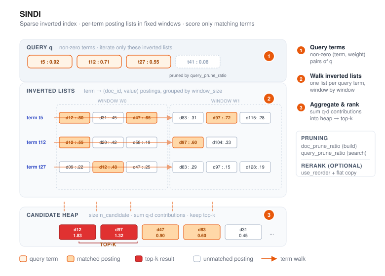

# SINDI



SINDI (**S**parse **IN**verted **D**ense **I**ndex) is VSAG's index for **sparse
vectors** — the kind produced by BM25, SPLADE, and other learned-sparse encoders.
Unlike the dense indexes (HGraph, IVF), SINDI operates directly on term/value
pairs and is one of the VSAG indexes that accepts `dtype: "sparse"`.

- Source: `src/algorithm/sindi/`
- Example: [`examples/cpp/109_index_sindi.cpp`](https://github.com/antgroup/vsag/blob/main/examples/cpp/109_index_sindi.cpp)

## How it works

1. **Window-based inverted lists.** Documents are grouped into fixed-size windows
   (`window_size`). Within each window, an inverted list per term maps a term id
   to the `(doc_id, value)` pairs that mention it.
2. **Optional pruning and quantization.** During construction, `doc_prune_ratio`
   drops low-weight terms per document. `use_quantization: true` stores SQ8 values,
   while `use_quantization: "fp16"` stores half-precision values.
3. **Scoring.** At query time, SINDI iterates the non-zero terms of the query,
   walks the corresponding inverted lists in each window, aggregates contributions
   into a max-heap of size `n_candidate`, and returns the top-k. When `use_reorder`
   is enabled, the candidates are re-scored against a forward store. The default
   forward store keeps FP32 values. `rerank_type: "fp16"` stores half-precision
   values and converts them to FP32 for scoring, while `rerank_type: "dmq8"` uses
   a compressed DMQ store to reduce rerank memory further.

Distance is returned as `1 - inner_product` so results sort ascending as in the
dense indexes.

For deployments that need both in-memory and disk-based I/O, use
[SINDI_V2](sindi_v2.md).

## Quick start

```cpp
#include <vsag/vsag.h>

std::string params = R"({
    "dtype": "sparse",
    "metric_type": "ip",
    "dim": 1024,
    "index_param": {
        "term_id_limit": 30000,
        "window_size": 50000,
        "doc_prune_ratio": 0.0,
        "use_quantization": false,
        "use_reorder": false,
        "remap_term_ids": false
    }
})";
auto index = vsag::Factory::CreateIndex("sindi", params).value();

// Build a dataset of SparseVector.
auto base = vsag::Dataset::Make();
base->NumElements(n)
    ->SparseVectors(sparse_vectors)  // vsag::SparseVector*
    ->Ids(ids)
    ->Owner(false);
index->Build(base);

// Search.
auto query = vsag::Dataset::Make();
query->NumElements(1)->SparseVectors(&query_vec)->Owner(false);
auto result = index->KnnSearch(
    query, /*topk=*/10,
    R"({"sindi": {"n_candidate": 100}})").value();
```

## Build parameters

Build-time parameters live under `index_param`. `dtype` **must** be `"sparse"`
and `metric_type` **must** be `"ip"`.

| Parameter | Type | Default | Description |
|-----------|------|---------|-------------|
| `dim` | int | — (required) | Maximum number of non-zero elements per sparse vector. *Not* the vocabulary size. |
| `term_id_limit` | int | `1000000` | Upper bound on term id values (≥ max term id + 1, up to 50 000 000). |
| `window_size` | int | `50000` | Documents per window (range: 10 000 – 60 000). |
| `doc_prune_ratio` | float | `0.0` | Fraction of lowest-weight terms dropped per doc at build time (`[0.0, 1.0)`). |
| `term_prune_ratio` | float | `0.0` | Fraction of lowest-weight postings permanently removed per term per window during `Build`; `[0, 1)`, disabled by default. |
| `term_retain_threshold` | integer | `0` | Build-time posting cap per term, divided across windows; `0` disables the cap. |
| `use_quantization` | bool or string | `false` | `false` stores FP32 values, `true` stores SQ8 values, and `"fp16"` stores FP16 values. |
| `use_reorder` | bool | `false` | Keep a forward store and rescore candidates after coarse SINDI scoring. |
| `rerank_type` | string | `"fp32"` | Forward-store type used when `use_reorder` is enabled. `fp32` keeps exact values, `fp16` stores half-precision values while scoring in FP32, and `dmq8` stores compressed 8-bit DMQ codes. |
| `dmq_shared_codebook_threshold` | int | `1024` | With `rerank_type: "dmq8"`, terms occurring at most this many times share one codebook; more frequent terms keep independent codebooks. Set to `0` to disable sharing. |
| `remap_term_ids` | bool | `false` | Remap term IDs before indexing; useful when term IDs are sparse or have large gaps. |
| `avg_doc_term_length` | int | `100` | Hint for memory estimation only. |
| `immutable` | bool | `false` | Build or load the compact read-only runtime. `Build()` compacts completed windows as it proceeds to reduce peak memory; incremental `Add()` is rejected. |

> **`dim` vs `term_id_limit`.** For the sparse vector `{0:0.1, 2:0.5, 177:0.8}`,
> `dim` is `3` (three non-zero entries) while `term_id_limit` must be ≥ `178`
> (largest term id + 1). Sizing `term_id_limit` to your vocabulary is the most
> common first-time mistake.

### Sparse value formats

`use_quantization` retains its legacy boolean behavior and also accepts one string value:

| Value | Stored value format | Trade-off |
| --- | --- | --- |
| `false` | FP32 | Highest value precision and largest posting payload |
| `true` | SQ8 | Smallest posting values; quantization range is learned during the initial build |
| `"fp16"` | FP16 | Half the FP32 value bytes without SQ8 range calibration |

Indexes built with `false` or `true` retain the legacy serialization representation. Older VSAG
versions cannot parse a SINDI index that uses the new `"fp16"` value format; upgrade readers
before deploying FP16 artifacts.

### Rerank value formats

`rerank_type` controls the separate forward store created by `use_reorder: true`; it is independent
of the posting-list `use_quantization` setting. `fp16` keeps query values and accumulation in FP32
but stores document values in FP16. Because term IDs remain 32-bit, the core bytes per non-zero
forward-store entry decrease from 8 to 6 before record and block overhead. FP16 conversion adds
compute work, so latency may improve for memory-bound workloads but can regress for short or
cache-resident vectors. Measure with representative data.

Both `fp16` and `dmq8` require `use_reorder: true`. Older VSAG versions cannot read the FP16 rerank
payload.

### Immutable low-memory build

Set `immutable: true` when the completed SINDI index is read-only:

```json
{
    "dtype": "sparse",
    "metric_type": "ip",
    "dim": 1024,
    "index_param": {
        "term_id_limit": 30000,
        "window_size": 50000,
        "use_quantization": "fp16",
        "remap_term_ids": true,
        "immutable": true
    }
}
```

During `Build()`, each completed mutable window is compacted into an immutable payload and the
temporary window is released before construction continues. In the Sparse4M FP16 measurement
reported with this feature, peak build memory fell from 27.03 GB to 6.08 GB (77.51% lower), while
build time increased from about 330 seconds to 599 seconds. Treat these figures as workload-specific
evidence, not a capacity guarantee.

The immutable runtime supports KNN and range search plus legacy `Serialize`/`Deserialize`.
It rejects incremental `Add` and `GetSparseVectorByInnerId`. Single-ID
`CalcDistanceById` and batch `CalcDistancesById` (including the legacy `CalDistanceById` alias)
are supported; see [distance-by-ID](../advanced/calc_distance_by_id.md). Mutable and immutable runtimes both support `SerializeStreaming`,
`DeserializeStreaming`, and `Index::Load`.
The serialized index must be loaded into a SINDI created with the same `immutable` setting.
New indexes record the sorted posting-list format version and skip normalization when loaded.
Indexes written without this marker remain compatible and are normalized during loading.

### Host filtering

Mutable and immutable SINDI and [SINDI_V2](sindi_v2.md) indexes can group documents by their source
host and avoid returning documents from other hosts. Attach a complete string `host` array to a
host-aware `Build()` or mutable `Add()` batch. Use an empty string for a document with no host:

```cpp
base->NumElements(n)
    ->SparseVectors(sparse_vectors)
    ->Ids(ids)
    ->StringMetadata("host", base_hosts)
    ->Owner(false);
index->Build(base);

std::string query_host = "example.com";
query->NumElements(1)
    ->SparseVectors(&query_vec)
    ->StringMetadata("host", &query_host)
    ->Owner(false);
```

Each `Build()` or mutable `Add()` batch groups internal IDs by host while preserving external
labels. Host queries scan the relevant posting windows and apply exact membership checks over the
host's one or more internal-ID ranges. Repeated mutable `Add()` calls may append disjoint ranges for
the same host. Tombstones and an additional user `Filter` are applied together with host membership.

Host strings are matched byte for byte without case folding or URL normalization. VSAG assigns
compact internal IDs and persists the string-to-ID dictionary with the index; callers never provide
those IDs. The empty string is the missing-host bucket. Once a mutable index contains host metadata,
every later `Add()` must provide a complete `host` array; host metadata cannot be introduced after
host-unaware documents. An empty-string query searches only missing-host documents, while omitting
`host` preserves full-index KNN behavior. An unknown host returns an empty result. Indexes built
without base host metadata ignore query host metadata and retain their previous behavior. The old
numeric `host_id` input is rejected. Host filtering currently applies only to KNN; range search keeps
its existing full-index behavior.

### Publish-time filtering

Mutable and immutable SINDI can filter KNN queries by a document publication timestamp, with or
without reranking. Supply one Unix timestamp in seconds per base document through int64 metadata.
`0` means that the document has no publication time:

```cpp
int64_t base_times[] = {0, 1777593600, 1777680000};
base->Int64Metadata("publish_time_stamp", base_times);

int64_t query_time = 1777593600;
query->Int64Metadata("publish_time_stamp", &query_time)->Owner(false);

int64_t time_begin = 1777593600;
int64_t time_end = 1777766399;
query->Int64Metadata("publish_time_stamp_begin", &time_begin)
    ->Int64Metadata("publish_time_stamp_end", &time_end)
    ->Owner(false);
```

SINDI normalizes every positive timestamp to a UTC epoch day with `timestamp / 86400`. A single
timestamp matches every document on the same UTC day. A range is inclusive after both endpoints
are normalized to UTC days. The two range endpoints must be supplied together, must satisfy
`begin <= end`, and cannot be combined with the single-value selector. Query values must be
positive. Base values must be non-negative; negative values are rejected. Timestamps whose epoch
day exceeds `INT32_MAX` are rejected.

Documents with base value `0` remain searchable when a query omits time selectors, including
host-only queries, but never match a time query. Every base document still needs one array entry.
An index built without `publish_time_stamp` rejects a query that supplies any time selector.

A time-aware build orders documents by publication timestamp, cuts the ordered sequence into
logical partitions of `window_size` documents, and groups by host inside each partition. Missing
times form one final partition. Search first selects partitions whose UTC-day range intersects the
query, then applies exact per-document day and optional host checks before candidates enter the
heap. Time, host, tombstone, and user `Filter` conditions use AND semantics. Failed or skipped
documents can make adjacent logical partitions share a physical window; the exact day check keeps
boundary results correct.

Mutable time-aware indexes support incremental `Add()`. The initial `Build()` or first `Add()` on
an empty index must supply one `publish_time_stamp` value per vector; every later `Add()` must
also supply it and preserve whether host metadata is present. Each batch is sorted internally by
time and appended as a contiguous ID segment. Dates may overlap across batches, so older dates
can be backfilled. Missing-time documents remain at the end of each segment, and queries route
through matching partitions in every segment. An existing index without time metadata cannot
gain it through `Add()`. Publish-time filtering applies only to KNN and is preserved by standard
and streaming serialization; a restored mutable index can continue to accept time-aware `Add()`.
Immutable and DMQ8 rerank runtimes still reject incremental writes.
Many small `Add()` batches create many segments, so time-filtered queries check more segment
directories; batch inserts when practical.
The new time metadata format is v2: current readers accept v1 snapshots, while older readers
cannot load snapshots written in v2.

Queries without a time selector scan every time and missing-time partition. Host-only queries
select that host from every partition. Exact time filtering disables term-level posting pruning in
each selected window, so time queries may scan more postings than host-only queries; wider ranges
also select more windows. A host-only query on a time-enabled index can require a full scan for
windows that cross partition or host boundaries.

## Search parameters

Search-time parameters live under the `sindi` sub-object:

| Parameter | Type | Default | Description |
|-----------|------|---------|-------------|
| `n_candidate` | int | `0` | Candidate heap size. When `0`, defaults to `SPARSE_AMPLIFICATION_FACTOR · topk` (500×). If set, must satisfy `1 ≤ n_candidate ≤ SPARSE_AMPLIFICATION_FACTOR · topk`. |
| `window_parallelism` | int | `1` | Number of window-search workers (`1` to `16`). Workers run in a reusable thread pool and steal pending windows from one another. The merged heap keeps up to `n_candidate` candidates before reranking. When this is greater than `1`, KNN search ignores `timeout_ms`; window scanning for queries with a filter, active callback limit, or reasoning trace still uses one worker. |
| `worker_n_candidate` | int | `n_candidate` | Requested per-worker candidate heap capacity; omit to inherit the effective final candidate count. The actual capacity is at least the query top-k, so one matching window can still supply top-k results. If set, it must be positive and `worker_n_candidate × window_parallelism ≥` the final candidate count. For example, `n_candidate=500`, `window_parallelism=2`, and `worker_n_candidate=300` are valid. Reducing this value can lower recall when top candidates are unevenly distributed across workers; the aggregate capacity bound does not guarantee retaining the global top candidates. |
| `window_scheduler` | string | `"count_deque"` | Parallel KNN window scheduling: `count_deque` retains the count-based deque/try-lock implementation; `count_atomic` uses count-based contiguous ranges and shared atomic cursors; `cost_atomic` balances contiguous ranges by the sum of query-pruned, term-pruned posting scan counts, then uses atomic cursors. Each atomic worker drains its range and then visits other ranges in cyclic order. |
| `filter_callback_limit` | uint64 | `0` | Maximum user `Filter::CheckValid` callback invocations for one filtered search request. A value of `0` disables the limit. Internal checks such as the deleted-ID filter do not count. Reaching a positive limit stops candidate and window scanning after processing the final callback result and returns the already filtered candidates, so the result may be partial. The limit applies to KNN and range search through both the regular APIs and `SearchWithRequest`. |
| `query_prune_ratio` | float | `0.0` | Fraction of lowest-weight query terms skipped (`[0.0, 1.0)`). |
| `term_prune_ratio` | float | `0.0` | Fraction of the lowest-value postings skipped from each term list (`[0.0, 1.0)`). |
| `term_retain_threshold` | uint64 | `0` | Maximum postings for one term across all windows. A value of `0` disables this limit; positive values allow each non-empty window posting list to scan at most `max(1, floor(threshold / window_count))` postings. |

FP32/FP16 sparse KNN reranking automatically uses count-based static batches with the same parallelism as `window_parallelism` (capped by the candidate count). The caller participates using the same query thread pool; each worker writes distances at independent candidate positions, and final top-k selection follows the original candidate order. A single worker processes one batch. Reasoning queries, DMQ8 and range search retain scalar reranking. Library distance counters and result statistics remain enabled.

Parallel windows and reranking share one lazy index-owned query pool, capped at 16 threads and reported hardware concurrency (at least one). Query tasks are isolated from caller-supplied pools: those pools may contain writers waiting for the read lock held by the query. Parallel workers use thread-safe default scratch allocation for computers, score buffers, contexts and local heaps; request-allocator calls and final result allocation stay on the calling thread.

After combining the ratio and threshold limits, SINDI scans at least one posting from every
non-empty term list.

Within each window, postings for a term are sorted by their stored value in descending
order, then by internal document id in ascending order. If both term-prune limits are
enabled, the scanned prefix is the smaller of
`floor(list_size · (1 - ratio))` and `floor(threshold / window_count)`.
SINDI chooses the heap-insertion strategy automatically from the build-time
`doc_prune_ratio` and search-time `query_prune_ratio`. With the current `0.1`
threshold, SINDI uses the distance-array insertion path when both ratios are
`<= 0.1`; if either ratio is greater than `0.1`, it uses term-list heap
insertion. The legacy
`use_term_lists_heap_insert` search parameter is ignored; configure pruning
ratios instead.

```cpp
auto result = index->KnnSearch(
    query, topk,
    R"({"sindi": {"n_candidate": 200, "filter_callback_limit": 10000, "query_prune_ratio": 0.1}})").value();
```

## When to use SINDI

- Sparse retrieval with BM25, SPLADE, uniCOIL, or similar learned-sparse encoders.
- Hybrid dense+sparse pipelines where SINDI handles the sparse leg in parallel with
  HGraph / IVF for dense embeddings.
- Memory-constrained deployments of sparse corpora (`use_quantization: true` selects SQ8,
  while `"fp16"` halves FP32 posting value bytes; `use_reorder: true` trades
  forward-store memory for recall, `rerank_type: "fp16"` reduces forward-store
  value bytes with modest precision loss, and `rerank_type: "dmq8"` compresses
  that store further).
- Read-only snapshots that need lower peak build memory (`immutable: true`), accepting slower
  construction and no incremental writes.

SINDI does **not** accept dense vectors and supports only inner-product similarity.
Range search and id-based filtering are supported; see the example for usage.
When `rerank_type` is `dmq8`, codebooks are fixed by the initial build, so incremental
`Add` after the model is established and `UpdateVector` are not supported.

## Practical guidance

- For Chinese corpora, we recommend encoding sparse vectors with BGE-M3. For
    English corpora, SPLADE is the more common default.
- BGE-M3 can emit both sparse and dense vectors. Today SINDI handles the sparse
    leg, and VSAG plans to support fused sparse+dense scoring in a future release.
- Sparse vectors are not a complete replacement for BM25 full-text retrieval. In
    practice, three-way recall with BM25 + sparse + dense usually outperforms any
    two-way combination.
- At the index level, SINDI can also serve BM25-style scoring: use inverse
    document frequency as the query-side term weight, and use term-frequency-based
    weights as the document-side term value.

## Common configurations

1. Flat brute-force sparse index. Keep all non-zero terms in the inverted index
     (`doc_prune_ratio: 0.0`), disable the flat reranker (`use_reorder: false`),
     and disable quantization (`use_quantization: false`). This is the simplest
     high-recall baseline.
2. Pruned high-accuracy index. Prune most low-weight terms during build
     (`doc_prune_ratio: 0.4`), keep the flat copy for reranking
     (`use_reorder: true`), and enable quantization to shrink inverted-list memory
     (`use_quantization: true`). This is a common balance between memory and
     recall.
3. Pruned high-accuracy index with compressed reranking. Use the same pruning and
     inverted-list quantization as above, but set `rerank_type: "fp16"` together
     with `use_reorder: true` for a precision-oriented reduction in forward-store
     memory, or select `dmq8` for stronger compression.
4. Very large sparse vocabularies. When term IDs are sparse within the `uint32`
     range, such as hash-based tokenizers, external vocabulary IDs, or vocabularies
     with large gaps, enable `remap_term_ids: true`. This avoids managing many
     empty posting lists and helps stay below the `term_id_limit` ceiling.
5. Read-only low-memory build. Add `immutable: true`, normally together with
     `use_quantization: "fp16"` and `remap_term_ids: true`, when peak build memory matters more
     than build speed and the finished index will not receive incremental writes.

## Mark remove

SINDI supports `RemoveMode::MARK_REMOVE`. Calling `Remove(ids)` (the default mode)
tombstones the given ids so they no longer appear in search results;
`GetNumElements()` drops accordingly and `GetNumberRemoved()` reports the running
total. Removing an id that is absent or already removed is a no-op.
`RemoveMode::FORCE_REMOVE` is not supported and returns an error.

Mark-removed documents still occupy memory until the index is rebuilt; the space
is not physically reclaimed.

## See also

- [Creating an Index](../guide/create_index.md)
- [Index Parameters](../resources/index_parameters.md)
- [k-Nearest Neighbor Search](../guide/knn_search.md)

### Build-time term pruning

The index creation parameters also accept `term_prune_ratio` (float in `[0, 1)`, default `0`) and `term_retain_threshold` (non-negative integer, default `0`). Both default to disabled. During `Build`, each term's postings in each window are sorted by stored weight and permanently trimmed to the smaller of `floor(posting_count * (1 - term_prune_ratio))` and `floor(term_retain_threshold / window_count)`; a zero threshold imposes no cap, and non-empty lists retain at least one posting. Mutable and immutable builds support FP32, FP16 and SQ8. Rerank vectors and document labels are preserved. Search-time pruning operates on the retained postings; it cannot restore removed postings. Subsequent `Add` calls do not apply build-time pruning.

For example, set `"term_prune_ratio": 0.2, "term_retain_threshold": 0` inside the index's build parameters to remove the lowest-weight 20% of each posting list per window.
