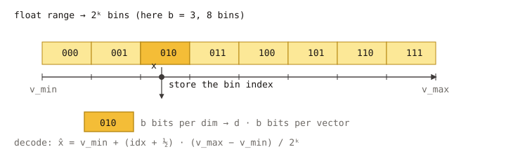

# Scalar Quantization (SQ4 / SQ8)

`sq8` and `sq4` are **per-dimension scalar quantizers**: each coordinate is
mapped from `float32` to an 8-bit (`sq8`) or 4-bit (`sq4`) integer using a
per-dimension `[min, max]` range learned during training. They share the
same implementation, parameterized by bit width, in
`src/quantization/scalar_quantization/scalar_quantizer.cpp` and
`scalar_quantizer_parameter.h`.

For SIMD-friendlier variants with a **global** `[min, max]`, see
[Scalar Uniform](sq_uniform.md).



## SQ4 vs SQ8 at a glance

| Type | Bits / dim | Memory vs fp32 | Typical accuracy | Notes |
| --- | --- | --- | --- | --- |
| `sq8` | 8 | ~1/4 | minor recall loss | General memory-saving baseline |
| `sq4` | 4 | ~1/8 | noticeable loss without reorder | Aggressive compression; pair with `use_reorder: true` |

The training is per-dimension `min`/`max`, so heavy-tailed coordinates can
waste code bits. If your data is anisotropic, consider either
[Scalar Uniform](sq_uniform.md) or a [Transform Quantizer](../advanced/quantization_transform.md)
chain like `"rom, sq8_uniform"` to rotate first.

## Memory cost (codes only)

- `sq8`: `dim` bytes per vector.
- `sq4`: `ceil(dim / 2)` bytes per vector.

There is also a small per-dimension range table (`8 × dim` bytes,
amortized across all vectors).

## Parameters

Neither `sq8` nor `sq4` has quantizer-specific JSON parameters today
(`scalar_quantizer_parameter.h:36-58`). The bit width is selected by the
`type` string alone.

```json
{
    "dtype": "float32",
    "metric_type": "l2",
    "dim": 128,
    "index_param": {
        "base_quantization_type": "sq8",
        "max_degree": 32,
        "ef_construction": 300,
        "use_reorder": true,
        "precise_quantization_type": "fp32"
    }
}
```

Replace `"sq8"` with `"sq4"` for 4-bit codes.

## Training

`NEED_TRAIN` is set. Training collects per-dimension `min` / `max` from a
sample of the input vectors. Calling `Build(base)` trains internally; on
indexes that require an explicit `Train` (some IVF flows), call it before
`Add`. See [Build and Train](../advanced/build_and_train.md).

## Metric compatibility

For `sq8` and `sq4`, `l2`, `ip`, `cosine` are all supported. Distances are computed by decoding
the integer codes back to per-dimension scaled floats.

## When to choose `sq8` vs `sq4`

- **`sq8`**: default memory-saving choice for graph indexes (HGraph,
  Pyramid) when ~4× memory reduction is the target. Recall loss is small
  enough that `use_reorder` is often optional, but enabling it with
  `precise_quantization_type: "fp32"` is the safest setup.
- **`sq4`**: choose when memory is tight and you can afford a precise
  reorder store. Almost always pair with `use_reorder: true`.
- Pick `sq*_uniform` instead when the data is roughly homogeneous across
  dimensions; the uniform variants have higher SIMD throughput.
- For heavy-tailed / anisotropic data, prefer a [Transform Quantizer](../advanced/quantization_transform.md)
  chain that rotates before quantization.

## Related pages

- [Scalar Uniform (SQ4 / SQ8 Uniform)](sq_uniform.md)
- [Transform Quantizer](../advanced/quantization_transform.md)
- [Quantization overview](./)

## Local SQ4 / SQ8 (float32 L2, IP and cosine)

HGraph accepts `sq4_local` and `sq8_local` as `base_quantization_type`, or as `precise_quantization_type` with `use_reorder: true`. Both support dense float32 L2, IP and cosine. For example, use RaBitQ traversal with local SQ4 reranking:

```json
{
    "dtype": "float32",
    "metric_type": "cosine",
    "dim": 128,
    "index_param": {
        "base_quantization_type": "rabitq",
        "use_reorder": true,
        "precise_quantization_type": "sq4_local",
        "max_degree": 32,
        "ef_construction": 300
    }
}
```

Replace `sq4_local` with `sq8_local` for eight-bit precision. Direct search uses, for example, `base_quantization_type: "sq8_local"` and `use_reorder: false`. Existing optional FP32 reranking remains available; local reranking does not add a hidden FP32 store or third reranking stage. The name `precise_quantization_type` does not guarantee exact distances: both local stores are lossy, and SQ4's coarser levels can reduce recall substantially. Choose precision and search settings using your own data.

### Design and layout

Each vector stores its own FP32 minimum `m` and FP32 scale `s = (max - min) / (2^bits - 1)`. Offsets 0–3 contain `m`, offsets 4–7 contain `s`, and codes start at offset 8. There is no padding or record alignment requirement.

| Type | Levels | Code payload | Bytes per vector |
| --- | --- | --- | --- |
| `sq8_local` | 256 | One unsigned byte per component | `dim + 8` |
| `sq4_local` | 16 | Even component in low nibble, odd component in high nibble | `ceil(dim / 2) + 8` |

For odd SQ4 dimensions the unused high nibble is zero. Code storage is `N * bytes_per_vector`, excluding graph, IDs, allocator capacity and optional other stores. Each query computer uses `4 * dim` scratch bytes. Cosine encoding additionally uses a temporary `4 * dim` normalization buffer.

Encoding rounds `(x - m) / s` to the nearest integer (half steps round upward) and clamps to [0, 255] or [0, 15]. Constant vectors use zero scale and zero codes. Decode reconstructs `m + s * code` with fused rounding (and finite endpoint clamping). Unlike `sq8` / `sq4`, ranges are per vector rather than trained per coordinate. Unlike uniform SQ, queries remain FP32.

### Metric definitions and normalization

- **L2:** squared Euclidean distance between the FP32 query and reconstructed database vector. Code-to-code distance reconstructs both operands independently.
- **IP:** `1 - dot(query, decoded_vector)`, retaining original magnitudes. Code-to-code uses `1 - dot(decoded_a, decoded_b)`. Both minimum offsets contribute to the dot product.
- **Cosine:** the quantizer applies the same `Normalize` routine as existing `ScalarQuantizer` to original database vectors before encoding, and to the FP32 query before ADC. Distance is then `1 - dot`, as above. Decoded vectors are not renormalized; quantization can change their norm, so results need not lie exactly in [0, 2]. Zero vectors remain zero; their cosine distance to any vector is 1.

HGraph passes the original vectors to these stores; the quantizer owns cosine normalization. The shared FP32 normalization semantics also apply to extreme values: norm overflow may produce zero normalized components, and underflow/denormal handling may preserve tiny components. This feature does not redefine the established normalization policy.

### Numeric and training contract

Other input dtypes and transform wrappers around local SQ are rejected. Negative and constant vectors are supported; encoding and query processing reject NaN and infinity. Range calculation uses double intermediates. Extreme finite records use a double-intermediate distance fallback, with reconstructed values clamped to finite FP32 endpoints. Distances outside the FP32 range can be infinite. Tiny ranges may round the FP32 scale to zero and are subject to platform denormal handling. SIMD results agree within floating-point tolerance, not necessarily bit for bit.

Dimensions from 1 to `INT_MAX`, odd dimensions and unaligned records are supported. Shared kernels cover scalar, SSE, AVX, AVX2, AVX512 and NEON paths; SVE uses the scalar fallback. SSE/AVX reconstruct lanes scalarly with fused rounding before SIMD accumulation so that ADC agrees with the public decoder. Native ARM execution was unavailable for this change's local validation.

There are no learned shared bounds or extra parameters. `Train` / `ReTrain` complete without consuming samples; encoding computes each vector's metadata. HGraph reports `NEED_TRAIN` as false when either local type is the base store. HGraph's normal Build/Train lifecycle still applies.

### Persistence and Tune

Existing `sq8`, `sq4`, `sq8_uniform`, defaults and their formats are unchanged.

The local types require readers that support them. Records and quantizer metadata use existing native binary conventions, not a new cross-endian format. Loading validates dimension, metric and record length. HGraph serialization preserves base and precise stores, including RaBitQ plus either local quantizer. Tune can create them from retained raw data or FP32 codes; lossy local codes alone cannot supply a later precision-changing Tune. Existing `ignore_reorder`, `reorder_source` and Tune restrictions remain applicable.

No broad recall/throughput benchmark campaign accompanies this change.
