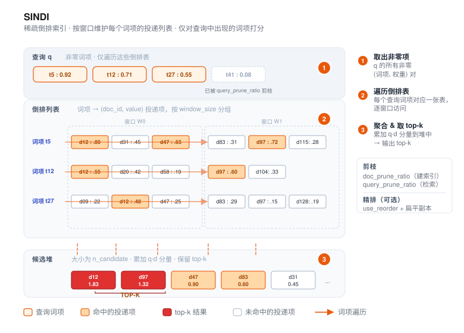

# SINDI



SINDI（**S**parse **IN**verted **D**ense **I**ndex）是 VSAG 面向 **稀疏向量** 的索引——
例如 BM25、SPLADE 以及其他学习稀疏（learned sparse）编码器产出的向量。与稠密索引
（HGraph、IVF）不同，SINDI 直接在“词项-权重”对上工作，是 VSAG 中接受
`dtype: "sparse"` 的索引之一。

- 源码：`src/algorithm/sindi/`
- 示例：[`examples/cpp/109_index_sindi.cpp`](https://github.com/antgroup/vsag/blob/main/examples/cpp/109_index_sindi.cpp)

## 工作原理

1. **基于窗口的倒排表。** 文档按固定窗口大小（`window_size`）分组，每个窗口独立维护一套
   倒排表——即“词项 → `(doc_id, value)` 列表”的映射。
2. **可选的剪枝与量化。** 构建时可通过 `doc_prune_ratio` 按文档粒度丢弃权重最低的词项；
   `use_quantization: true` 使用 SQ8，`use_quantization: "fp16"` 使用半精度值。
3. **打分。** 检索时，SINDI 遍历查询向量的非零项，按窗口访问对应的倒排表，使用大小为
   `n_candidate` 的大顶堆聚合得分，最后取 top-k。启用 `use_reorder` 时，候选会在正排
   存储上重打分。默认正排存储保留 FP32 值；设置 `rerank_type: "fp16"` 时以半精度
   保存 value、打分时转为 FP32；设置 `rerank_type: "dmq8"` 时使用压缩的 DMQ 正排，
   进一步降低重排内存。

返回的距离为 `1 - inner_product`，使结果与稠密索引一样按升序排序。

需要同时支持内存与磁盘 I/O 时，请选择 [SINDI_V2](sindi_v2.md)。

## 快速开始

```cpp
#include <vsag/vsag.h>

std::string params = R"({
    "dtype": "sparse",
    "metric_type": "ip",
    "dim": 1024,
    "index_param": {
        "term_id_limit": 30000,
        "window_size": 50000,
        "doc_prune_ratio": 0.0,
        "use_quantization": false,
        "use_reorder": false,
        "remap_term_ids": false
    }
})";
auto index = vsag::Factory::CreateIndex("sindi", params).value();

// 使用 SparseVector 构建数据集。
auto base = vsag::Dataset::Make();
base->NumElements(n)
    ->SparseVectors(sparse_vectors)  // vsag::SparseVector*
    ->Ids(ids)
    ->Owner(false);
index->Build(base);

// 执行检索。
auto query = vsag::Dataset::Make();
query->NumElements(1)->SparseVectors(&query_vec)->Owner(false);
auto result = index->KnnSearch(
    query, /*topk=*/10,
    R"({"sindi": {"n_candidate": 100}})").value();
```

## 构建参数

构建参数放在 `index_param` 下。`dtype` **必须** 为 `"sparse"`，`metric_type` **必须**
为 `"ip"`。

| 参数 | 类型 | 默认值 | 说明 |
|------|------|--------|------|
| `dim` | int | —（必填） | 单条稀疏向量允许的最大非零项数量，**不是** 词表大小 |
| `term_id_limit` | int | `1000000` | 词项 ID 的上界（应 ≥ 最大词项 ID + 1，最高 50 000 000） |
| `window_size` | int | `50000` | 每个窗口容纳的文档数（取值范围 10 000 – 60 000） |
| `doc_prune_ratio` | float | `0.0` | 构建阶段按文档丢弃权重最低词项的比例，取值范围为 `[0.0, 1.0)` |
| `term_prune_ratio` | float | `0.0` | `Build` 时每个窗口内各 term 永久裁剪的低权重 postings 比例，范围 `[0, 1)`，默认关闭。 |
| `term_retain_threshold` | integer | `0` | 构建时每个 term 的 postings 数量上限，平均分配到各窗口；`0` 表示不限制。 |
| `use_quantization` | bool 或 string | `false` | `false` 存 FP32，`true` 存 SQ8，`"fp16"` 存 FP16 |
| `use_reorder` | bool | `false` | 是否保留一份正排存储，在 SINDI 粗排后对候选做精排 |
| `rerank_type` | string | `"fp32"` | `use_reorder` 开启时使用的正排存储类型。`fp32` 保留精确值；`fp16` 以半精度保存、以 FP32 打分；`dmq8` 使用压缩的 8-bit DMQ 编码 |
| `dmq_shared_codebook_threshold` | int | `1024` | `rerank_type: "dmq8"` 时，出现次数不超过该值的 term 共用一个 codebook；更高频的 term 保持独立 codebook。设为 `0` 可关闭共享 |
| `remap_term_ids` | bool | `false` | 是否在建索引前重映射词项 ID，适用于词项 ID 很稀疏或存在大量空洞的词表 |
| `avg_doc_term_length` | int | `100` | 仅用于内存估算 |
| `immutable` | bool | `false` | 构建或加载紧凑的只读运行态；`Build()` 会逐窗口压缩以降低峰值内存，增量 `Add()` 会被拒绝 |

> **`dim` 与 `term_id_limit` 的区别。** 对于稀疏向量 `{0:0.1, 2:0.5, 177:0.8}`，
> `dim` 为 `3`（三个非零项），而 `term_id_limit` 至少应为 `178`（最大词项 ID + 1）。
> `term_id_limit` 要按词表大小估计，这是使用时最常见的坑。

### 稀疏值格式

`use_quantization` 保留原有 bool 行为，同时新增一个字符串取值：

| 取值 | 存储格式 | 取舍 |
| --- | --- | --- |
| `false` | FP32 | 词项权重精度最高，posting payload 最大 |
| `true` | SQ8 | 权重存储最小；首次构建时学习量化范围 |
| `"fp16"` | FP16 | 权重字节数为 FP32 的一半，不需要 SQ8 范围校准 |

使用 `false` 或 `true` 构建的索引仍保留旧版序列化表示。旧版本 VSAG 无法解析使用新
`"fp16"` 格式的 SINDI 索引；部署 FP16 产物前应先升级读取端。

### 重排值格式

`rerank_type` 控制 `use_reorder: true` 创建的独立正排存储，与倒排表的
`use_quantization` 无关。`fp16` 保持查询 value 和累加为 FP32，只把文档 value 存成
FP16。由于 term ID 仍为 32-bit，在不计记录与块开销时，每个正排非零项的核心存储从
8 字节降到 6 字节。FP16 转换会增加计算指令，因此受内存带宽限制时延迟可能下降，短向量
或已在缓存中的数据也可能变慢，应使用代表性数据实测。

`fp16` 和 `dmq8` 都要求设置 `use_reorder: true`。旧版本 VSAG 无法读取 FP16 重排 payload。

### 不可变低内存构建

完成后的 SINDI 只读时，可以设置 `immutable: true`：

```json
{
    "dtype": "sparse",
    "metric_type": "ip",
    "dim": 1024,
    "index_param": {
        "term_id_limit": 30000,
        "window_size": 50000,
        "use_quantization": "fp16",
        "remap_term_ids": true,
        "immutable": true
    }
}
```

`Build()` 会把每个完成的可变窗口压缩成不可变 payload，并在继续构建前释放临时窗口。该功能
提交时的 Sparse4M FP16 实测中，构建峰值内存从 27.03 GB 降到 6.08 GB（降低 77.51%），
构建时间则从约 330 秒增加到 599 秒。这些数字是特定负载的实测证据，不是容量保证。

不可变运行态支持 KNN、范围搜索以及旧版 `Serialize`/`Deserialize`。它不支持增量
`Add` 与 `GetSparseVectorByInnerId`。支持单 ID `CalcDistanceById` 和批量
`CalcDistancesById`（包括旧名 `CalDistanceById`），详见[按 ID 计算距离](../advanced/calc_distance_by_id.md)。
mutable 和 immutable 运行态均支持 `SerializeStreaming`、`DeserializeStreaming` 与
`Index::Load`。
反序列化时，新建 SINDI 的 `immutable` 设置必须与存储格式一致。
新索引会记录有序倒排链格式版本，加载时可跳过归一化排序；缺少该标记的旧索引仍保持兼容，
并在加载时完成排序归一化。

### Host 过滤

mutable 和 immutable SINDI 及 [SINDI_V2](sindi_v2.md) 索引都可以按来源 host 对文档
分组，避免返回其他 host 的文档。host-aware `Build()` 或 mutable `Add()` 批次需要提供完整的
字符串 `host` 数组；没有 host 的文档使用空字符串：

```cpp
base->NumElements(n)
    ->SparseVectors(sparse_vectors)
    ->Ids(ids)
    ->StringMetadata("host", base_hosts)
    ->Owner(false);
index->Build(base);

std::string query_host = "example.com";
query->NumElements(1)
    ->SparseVectors(&query_vec)
    ->StringMetadata("host", &query_host)
    ->Owner(false);
```

每个 `Build()` 或 mutable `Add()` 批次都会按 host 对 inner ID 分组，同时保持 external label
不变。host 查询统一扫描相关 posting window，并在该 host 的一个或多个 inner-ID 区间上执行
精确成员检查。多次 mutable `Add()` 可以为同一 host 追加互不连续的区间；删除标记和额外的
用户 `Filter` 会与 host 成员检查共同生效。

host 字符串按字节精确匹配，不做大小写折叠或 URL 归一化。VSAG 在内部为字符串分配紧凑 ID，
并将字符串到 ID 的字典随索引落盘；调用方不需要接触这些 ID。空字符串是缺失 host 分组。
mutable 索引一旦包含 host metadata，后续每次 `Add()` 都必须提供完整的 `host` 数组；已有
host-unaware 文档后不能再引入 host metadata。空字符串查询只检索缺失 host 的文档，不提供
`host` 时保留全索引 KNN 行为；未知 host 返回空结果。构建时没有 base host metadata 的索引会
忽略查询 host metadata，行为保持不变。旧的数值 `host_id` 输入会被拒绝。host 过滤当前仅适用于
KNN；范围搜索仍使用原有全索引路径。

### 发布时间过滤

mutable 和 immutable SINDI 无论是否开启 rerank，都可以按文档发布时间过滤 KNN 查询。构建时通过
int64 metadata 为每篇文档附加一个 Unix 秒时间戳；`0` 表示该文档没有发布时间：

```cpp
int64_t base_times[] = {0, 1777593600, 1777680000};
base->Int64Metadata("publish_time_stamp", base_times);

int64_t query_time = 1777593600;
query->Int64Metadata("publish_time_stamp", &query_time)->Owner(false);

int64_t time_begin = 1777593600;
int64_t time_end = 1777766399;
query->Int64Metadata("publish_time_stamp_begin", &time_begin)
    ->Int64Metadata("publish_time_stamp_end", &time_end)
    ->Owner(false);
```

SINDI 使用 `timestamp / 86400` 把每个正时间戳归一化为 UTC epoch day。单值查询匹配同一 UTC 日的
所有文档；范围查询把两个端点归一化后按闭区间匹配。两个范围端点必须同时提供、满足
`begin <= end`，并且不能与单值 selector 同时使用。query 值必须大于 `0`；base 值必须非负，
负数会被拒绝。换算后的 epoch day 超过 `INT32_MAX` 时同样报错。

base 值为 `0` 的文档在不提供时间 selector 时仍可检索，仅按 host 查询时也会包含 host 匹配的
无时间文档；任何时间查询都不会命中这些文档。每篇 base 文档仍须在数组中占一项。没有使用
`publish_time_stamp` 构建的索引收到任一时间 selector 时会报错。

时间构建先按发布时间排序，再按 `window_size` 个文档切分逻辑分区，并在每个分区内按 host 分组；
无时间文档合并为末尾的单独分区。查询先选择 UTC day 范围相交的分区，再在候选进入 heap 前执行
精确的逐文档 day 与可选 host 检查。时间、host、删除标记和用户 `Filter` 使用 AND 语义。插入失败
或跳过的文档可能让相邻逻辑分区共享同一个物理 window，精确 day 检查会保证边界结果正确。

mutable 时间索引支持增量 `Add()`。初次 `Build()` 或空索引上的第一次 `Add()` 必须提供每个向量的
`publish_time_stamp`；后续每批 `Add()` 也必须提供，并保持是否提供 host metadata 的模式一致。
每批数据各自按时间排序并追加为一个连续 ID 段；不同批次的日期可以重叠，因此可以补录旧日期。
每个段内的无时间文档位于末尾，查询会逐段选择匹配分区。没有时间 metadata 的已有索引不能通过
`Add()` 转为时间索引。发布时间过滤仅作用于 KNN，由普通与 streaming 序列化共同保存；恢复后的
mutable 时间索引仍可继续 `Add()`。immutable 和 DMQ8 重排运行态仍不支持增量写入。
大量小批次 `Add()` 会形成较多时间段，时间查询需检查更多段目录；可行时宜批量写入。
新的时间元数据使用 v2 格式：当前版本可读取 v1 快照，旧版本不能读取新写出的 v2 快照。

不提供时间 selector 时会扫描全部时间分区与无时间分区；仅提供 host 时会从每个分区选择该 host。
精确时间过滤会关闭所选 window 的 term 级 posting 剪枝，因此时间查询可能比仅 host 查询扫描更多
posting，较宽的范围也会选择更多 window。在启用时间的索引上，仅 host 查询遇到跨分区或 host
边界的 window 时也可能需要完整扫描。

## 检索参数

检索参数放在 `sindi` 子对象下：

| 参数 | 类型 | 默认值 | 说明 |
|------|------|--------|------|
| `n_candidate` | int | `0` | 近似候选预算，有效大小为 `N = max(n_candidate, topk)`。省略或设为 0 时使用 topk，而不是 500；较大的候选池须显式配置，可增加进入精排的候选及计算成本，不保证精确召回或串并行结果完全一致。 |
| `window_parallelism` | int | `1` | 含调用线程的执行槽位数上限，取值 `1` 至 `16`。省略或为 1 使用原串行候选堆；大于 1 启用固定分区近似执行器，首版只支持 immutable 内存 KNN。资源准入可降低实际槽位数，候选计划保持不变。 |
| `parallel_n_candidate_ratio` | number | `2` | 有限且 ≥1。所有局部堆的总容量为 `ceil(倍率 × max(n_candidate, topk))`，独立于执行槽位数分配到固定逻辑分区。增大容量允许保留更多候选并增加成本，不保证保留串行候选集或特定召回率；串行模式只校验该值，不应用它。 |
| `profile_cpu` | bool | `false` | 串行和并行 KNN 的诊断选项。采集调用线程参数解析后至统计序列化前的 CPU 时间，并累加后台 window worker 的 CPU 时间；关闭时不读取线程 CPU 时钟。 |
| `filter_callback_limit` | uint64 | `0` | 单次带过滤检索最多调用用户 `Filter::CheckValid` 回调的次数；`0` 表示不限制。删除 ID 过滤器等内部检查不计数。达到正数上限时，在正常处理最后一次回调结果后停止候选及后续窗口扫描，并返回已经通过过滤的候选，因此结果可能不完整。该限制同时适用于 KNN、范围检索以及常规 API 和 `SearchWithRequest` |
| `query_prune_ratio` | float | `0.0` | 查询时丢弃权重最低查询项的比例，取值范围为 `[0.0, 1.0)` |
| `term_prune_ratio` | float | `0.0` | 每条倒排链中按 value 丢弃低权 posting 的比例，取值范围为 `[0.0, 1.0)` |
| `term_retain_threshold` | uint64 | `0` | 单个 term 在所有 window 中最多扫描的 posting 总数；`0` 表示关闭此限制，正数使每个 window 的非空 posting list 最多扫描 `max(1, floor(threshold / window_count))` 个 |

逻辑分区数还受 `floor(总候选容量 / topk)` 限制，保证每个局部堆至少可保留 TopK，同时不突破总候选预算。候选预算较小时，可用的执行槽位也可能减少。

例如，省略 `n_candidate` 时 N=topk，默认倍率2最多提供两个分区和两个实际执行槽位；即使请求P4/P8/P16，也受此限制，window或资源更少时还会进一步降低。topk=100、n_candidate=500、倍率2时，总容量1000，最多十个分区，资源允许时可以运行P4/P8。P是上限，提高P不会自动扩大候选预算。若需要更多分区，应显式增加N或倍率，并同时评估效果和额外计算成本。该分区数与早期压测版本不同，历史P4/P8性能数据不代表当前版本已经复测。


并行 KNN 通过两个入口时均保留原调用开始时间，包括等待索引结构锁的耗时；`SearchWithRequest` 委托检索不会重置超时。并行候选插入循环会检查共享停止条件，即使剩余分数不会再触发 Filter 回调也能退出；最后一次获准回调的结果先完成处理再停止。未启用扫描取消时仍采用原有特化循环。

### 并行候选质量与调参

并行检索同时改变候选选择策略和执行方式。串行使用一个全局候选堆；并行将 `ceil(parallel_n_candidate_ratio * N)` 容量分配给固定分区，再合并截取 N 个候选后复用相同精排。高分候选集中在某一分区时，可能超过局部配额；近似距离同分的文档也可能具有不同的精排距离。`query_prune_ratio=0` 只关闭查询词剪枝，不消除分区配额、构建剪枝或量化影响，不能保证串并行结果完全一致。

固定查询、Filter、输出 TopK 和 deadline，每次只调整一个维度：

- `window_parallelism` 改变执行槽位，不扩大候选计划。
- `parallel_n_candidate_ratio` 扩大局部候选堆，可缓解分区配额不足；不扩大最终 N 个候选的截断边界，因此不一定消除该处的近似同分取舍。
- `n_candidate` 同时扩大局部预算及进入精排的最终候选池，可能改善返回得分，也会增加计算和耗时，并可能改变串行结果。
- 降低 `query_prune_ratio` 可在额外计算成本下保留更多查询词，同时改变质量基线；串并行对照应使用相同剪枝参数和 N。

质量比较需区分结果完全一致、等分文档替换及排名得分变化。修改默认值前先验证代表负载；返回得分提高不等同于已测得真实召回率或业务相关性提升。调参用例只能证明该用例的规避效果，不能据此承诺通用参数保证。

新并行路径保持串行精排，包括 DMQ8。候选分区数为 `min(16, 有效window数, max(n_candidate, topk))`，采用固定连续分区，在最多 4 个 window 的 chunk 边界交接执行权；堆归属于逻辑分区，不归属于物理线程。并行模式明确拒绝 Range、reasoning 和 mutable/disk datacell。

带 Filter 的新模式要求该 Filter 同时实现 `vsag/concurrent_filter.h` 中的可选 `ConcurrentFilterProvider` 能力。非阻塞 lease 提供 label 空间下的独立 evaluator，每个 evaluator 同时只属于一个逻辑槽位；不支持的 Filter 明确失败。callback 总预算在同一次调用的所有分区间共享；deadline 停止新工作并在 drain 后返回错误，callback 预算耗尽可交付已验证候选。

显式共享的查询资源结合 CPU affinity、可读取的 cgroup CPU 配额和该资源组的活动调用限制额外 worker。`SearchResourceOptions::max_background_workers` 可降低额外 worker 上限；`VSAG_SINDI_MAX_CANDIDATES` 控制单次调用的总堆容量上限（缺省 1,048,576），在创建计划时读取。worker scratch 与调用方 arena 隔离；这些控制不代表已限制整个服务的 CPU 或内存。生产参数须通过独立效果集及目标并发下的 P95/P99 验证后选择。

CPU 准入根据进程的 cgroup membership 和挂载信息定位 v1/v2 层级，取可见祖先中可读取 CPU 配额的最小值。查询池配置是初始化快照，不是整个服务的 CPU 限流或动态扩缩容策略。

并行结果统计提供 `sindi_requested_slots`、`sindi_granted_slots`、`sindi_filter_slots`（首次 Filter 租约容量）、`sindi_cpu_slots`、`sindi_worker_limit`、`sindi_partitions`、`sindi_candidate_capacity`、`sindi_n_candidate`、`sindi_windows_processed`、`sindi_execution_complete` 和 `sindi_stop_reason`。既有 `complete` 表示距离计数覆盖是否完整，存在未计数的近似计算时为 false，不表示窗口计划没有执行完。deadline 和 worker 异常仍在回收所有任务后返回错误；deadline 在窗口边界和每 32 次 Filter 回调协作检查，callback permit 上限逐回调精确检查。

成功的并行结果中，`sindi_stop_reason` 为 `none` 或 `callback_limit`。deadline 和 worker 错误不返回结果 Dataset，因此不能依赖结果统计读取失败时的内部 stop 状态。原串行超时路径仍可返回部分结果并设置 `is_timeout=true`；并行 deadline 在回收 worker 后以 `ErrorType::INTERNAL_ERROR` 和包含 deadline 的消息返回错误。`VSAG_SINDI_MAX_CANDIDATES` 仅接受无符号十进制数字，且须落在正 uint32 范围。

显式设置 `profile_cpu:true` 时，`sindi_cpu_time_enabled`、`sindi_cpu_time_complete` 表示采样启用和可用状态；`sindi_search_cpu_us` 为调用线程与后台 worker CPU 时间之和，`sindi_worker_cpu_us` 为后台部分，不可用时省略数值。这些值不含 VSAG 之前的 SQL/Filter 准备、统计序列化和最终阈值结果包装，不代表整条 SQL 的 CPU 成本。串行和并行对照应采用相同采样设置，服务级 CPU 另行监控。

合并 ratio 与 threshold 限制后，每条非空倒排链至少扫描一个 posting。

同一 window 内的单 term posting 先按实际存储值降序排列，值相同时按内部 doc id
升序排列。ratio 和 threshold 同时生效时，实际扫描
`floor(list_size · (1 - ratio))` 与 `floor(threshold / window_count)` 中的较小值。
SINDI 会根据构建阶段的 `doc_prune_ratio` 与检索阶段的 `query_prune_ratio`
自动选择堆插入策略。按当前 `0.1` 阈值，当两个比例都 `<= 0.1` 时，SINDI 使用
基于距离数组的入堆路径；只要任一比例大于 `0.1`，就使用基于 term-list 的入堆路径。
旧版 `use_term_lists_heap_insert` 检索参数会被忽略；请改用剪枝比例控制该行为。

```cpp
auto result = index->KnnSearch(
    query, topk,
    R"({"sindi": {"n_candidate": 200, "filter_callback_limit": 10000, "query_prune_ratio": 0.1}})").value();
```

## 何时选择 SINDI

- 使用 BM25、SPLADE、uniCOIL 等学习稀疏编码器的稀疏检索场景。
- 稠密 + 稀疏的混合检索管线：SINDI 负责稀疏一路，HGraph / IVF 负责稠密 embedding。
- 稀疏语料的内存受限部署：`use_quantization: true` 选择 SQ8，`"fp16"` 把 FP32
  倒排 value 字节数减半；`use_reorder: true` 以正排内存换召回，
  `rerank_type: "fp16"` 以较小精度损失降低正排 value 开销，`rerank_type: "dmq8"`
  可进一步压缩这部分存储。
- 需要降低构建峰值内存的只读快照：使用 `immutable: true`，接受更慢的构建和不能增量写入。

SINDI **不支持** 稠密向量，只支持内积相似度。范围检索与基于 ID 的过滤均已支持，
具体用法参见示例代码。
当 `rerank_type` 为 `dmq8` 时，码本由首次构建固定，因此模型建立后的增量 `Add`
和 `UpdateVector` 不受支持。

## 实践建议

- 中文数据集的稀疏向量，推荐使用 BGE-M3 编码；英文数据集更常见的默认选择是
    SPLADE。
- BGE-M3 同时支持 sparse 和 dense 输出。当前 SINDI 负责稀疏一路，VSAG 未来计划
    支持稀疏与稠密融合打分检索。
- 稀疏向量不能完全替代 BM25 全文检索。实践中，BM25 + 稀疏向量 + 稠密向量的三路
    召回通常优于任意两路组合。
- 在索引层面，SINDI 也可以承载 BM25 风格打分：查询侧用逆文档频率作为词项权重，
    文档侧用词频等特征计算出的词项权重作为向量值即可。

## 常用配置

1. 扁平暴力搜索索引。倒排索引保留全部非零项（`doc_prune_ratio: 0.0`），不保留正排索引
    重排（`use_reorder: false`），不开启量化（`use_quantization: false`）。这是最直接的
     高召回基线。
2. 剪枝高精索引。构建时剪掉大部分低权重词项（`doc_prune_ratio: 0.4`），保留正排索引
     用于重排（`use_reorder: true`），并开启量化减少倒排索引内存
     （`use_quantization: true`）。这是常见的精度与内存折中配置。
3. 压缩正排重排索引。在上一种配置基础上，将 `rerank_type: "fp16"` 与
     `use_reorder: true` 一起使用，在侧重精度的前提下降低正排内存；需要更高压缩率时
     可选择 `dmq8`。
4. 超大稀疏词表支持。对于词项 ID 在 `uint32` 范围内非常稀疏的场景，例如基于哈希的
     分词器、外部词表 ID，或存在大量空白区间的词表，建议设置 `remap_term_ids: true`。
     这样可以避免管理大量空倒排列表带来的内存浪费，也能降低触达 `term_id_limit`
     上限的风险。
5. 只读低内存构建。当构建峰值内存比构建速度更重要，且完成后不再增量写入时，增加
     `immutable: true`，通常配合 `use_quantization: "fp16"` 与
     `remap_term_ids: true` 使用。

## 标记删除

SINDI 支持 `RemoveMode::MARK_REMOVE`。调用 `Remove(ids)`（默认模式）会为给定的 id
打上删除标记：它们不再出现在检索结果中，`GetNumElements()` 相应减少，
`GetNumberRemoved()` 返回累计删除数量。删除不存在或已删除的 id 不会有任何效果。
`RemoveMode::FORCE_REMOVE` 不支持，调用会返回错误。

被标记删除的文档在索引重建前仍占用内存，空间不会被物理回收。

## 相关文档

- [创建索引](../guide/create_index.md)
- [索引参数](../resources/index_parameters.md)
- [k-近邻搜索](../guide/knn_search.md)

### 构建时 term 裁剪

索引创建参数也支持 `term_prune_ratio`（浮点数，范围 `[0, 1)`，默认 `0`）和 `term_retain_threshold`（非负整数，默认 `0`），默认均不开启。`Build` 时，每个窗口内各 term 的倒排列表按存储权重降序排列，永久保留 `floor(posting_count * (1 - term_prune_ratio))` 与 `floor(term_retain_threshold / window_count)` 中较小数量的 postings；阈值为 0 表示不限制数量，非空列表至少保留一条。可变、不可变构建均支持 FP32、FP16 和 SQ8。重排向量及文档标签保持完整。搜索时裁剪作用于构建后保留的 postings，无法恢复已删除的 postings。后续 `Add` 不执行构建时裁剪。

例如，在索引构建参数中设置 `"term_prune_ratio": 0.2, "term_retain_threshold": 0`，可删除每个窗口内各倒排列表中权重最低的 20% postings。

### 检索资源提前准备

运行环境初始化时，以普通 `vsag::Resource` 构造通用 `vsag::SearchResource`，传给 `vsag::Engine` 后再创建索引。查询执行资源组与普通线程池分离，构造返回前确认所有 worker 已启动；构造失败抛异常，调用方可以重试。`SearchResourceOptions::max_background_workers` 可选，默认可见 CPU 预算减调用线程、至多 512；0 表示已准备但没有后台 worker。SINDI 单请求仍至多使用 16 个槽。

Engine 借用期间必须保留 Resource；索引持有共享查询资源组，最后一个持有者释放时回收线程池。分别构造的 SearchResource 使用独立资源组；需要组合不同普通资源并共享查询池/准入时，使用 `SearchResource(other_common, existing_search_resource)`。普通 Resource 不隐式获取查询线程。进程级持有由集成层决定，VSAG 没有隐藏全局查询池。

查询不建池。资源未准备成功时，P>1的KNN请求使用有效P1，直接复用原串行分支：
单个全局候选堆、原过滤回调预算及串行超时处理；不应用并行候选倍率，不创建逻辑分区
候选计划。独立Filter提供者为该串行调用租用一个evaluator。诊断标记serial、原请求P、
granted=1和`sindi_resources_ready=false`。降级结果以显式P1为对照，不保证与已准备
资源后的并行候选计划相同。串行请求无需准备；VSAG不读取VecBase在线配置。


每个独立 SearchResource 在构造期间同步创建自己的 worker 组。存在多个索引组的宿主应显式设置 `max_background_workers`，并按需复用共享 SearchResource；VSAG 不跨独立资源组实施进程级线程总预算。
